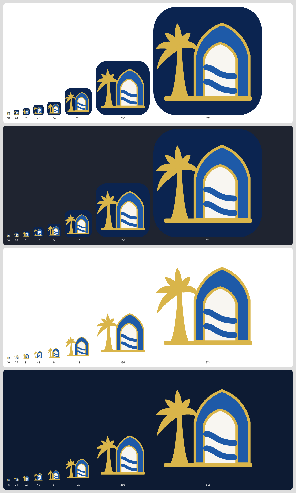
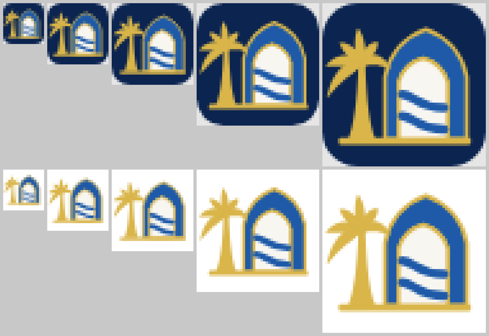

# IQDI_APP_ICON_QA

**Assets:**
- `iqdi-app-icon.svg`: navy rounded square + symbol. Used for PWA icons, favicons and the header.
- `iqdi-icon-small.svg`: the symbol on a transparent background.

Both use a 120 × 120 grid and flat colours. They contain the palm, the arch and two river lines. They contain **no lion, no tiles, no text and no gradients** (enforced by a unit test).

## Method

- The SVG was rendered in Chromium at exact pixel sizes (`deviceScaleFactor 1`) by `scripts/brand-assets.mjs`.
- It was checked on white, a dark UI grey `#1F2430` and night navy (`images/icon-ladder.png`).
- The small sizes were enlarged ×8 with nearest-neighbour scaling, so real pixels are judged (`images/icon-small-sizes-zoomed.png`).
- The assessment is visual, by eye, and recorded below. It was not tested with users.

## Results by size

| Size | Palm | Arch and opening | Two rivers separate | Verdict |
|---|---|---|---|---|
| 1024 | Clear | Clear | Clear | Good |
| 512 | Clear | Clear | Clear | Good |
| 256 | Clear | Clear | Clear | Good |
| 128 | Clear | Clear | Clear | Good |
| 64 | Clear | Clear | Clear | Good |
| 48 | Clear | Clear | Clear | Good |
| 32 | Recognisable (star-like crown) | Clear | Visible, thin | **Acceptable** |
| 24 | Silhouette | Clear | Faint, but two lines | **Borderline**: the meaning holds |
| 16 | Silhouette | Shape visible | **Merged into one texture** | **Silhouette only**: favicon use, not a meaning carrier |

**Not claimed:** that the icon is "fully clear" at every size. At 16 px only the overall silhouette (palm + arch + light opening) survives.

## Delivered icon files

| File | Size | Purpose |
|---|---|---|
| `apps/wallet-web/public/icons/icon-192.png` | 192 × 192 | Manifest `any` |
| `apps/wallet-web/public/icons/icon-512.png` | 512 × 512 | Manifest `any` |
| `apps/wallet-web/public/icons/icon-maskable-512.png` | 512 × 512 | Manifest `maskable`. Symbol inside the 80 % safe zone (82 px padding = 16 %), full-bleed navy |
| `apps/wallet-web/public/icons/apple-touch-icon.png` | 180 × 180 | iOS home screen (NOT tested on a device) |
| `apps/{wallet,verifier}-web/public/favicon.svg` | vector | Browser tab (modern browsers) |
| `apps/{wallet,verifier}-web/public/favicon-32.png` | 32 × 32 | Fallback favicon |
| `assets/branding/png/iqdi-app-icon-{16…1024}.png`, `iqdi-icon-small-{16…1024}.png` | 9 sizes each | Derived for other uses |

## Checked from the built apps

`scripts/brand-check.mjs` (a required verify step) loads the **production builds** and checks:
- both favicons are served (`image/svg+xml`, 32 × 32 PNG);
- every manifest icon's real pixel size matches its declared `sizes`;
- a maskable icon is present;
- `theme_color` is `#0B2450`;
- the apple-touch icon is 180 × 180.

**Not tested:**
- installation on a real Android or iOS home screen;
- launcher masking on real devices;
- the macOS or Windows taskbar.

All are recorded as NOT RUN.
