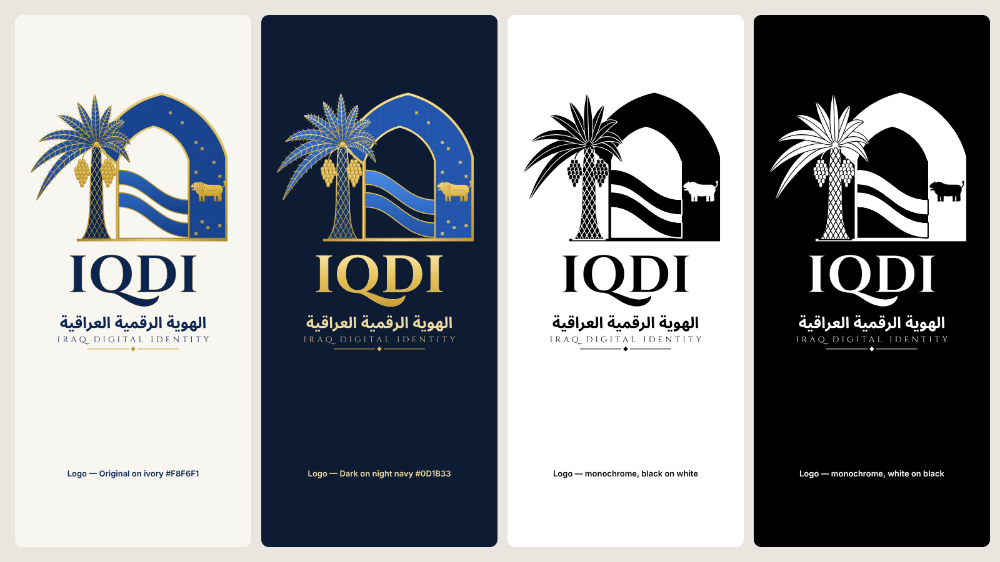

# IQDI Brand Guidelines

**IQDI — Iraqi Digital Identity · الهوية الرقمية العراقية.** TEST ONLY prototype.

This is the project's own visual identity. It is **not** a government emblem and carries **no** official endorsement. Never pair it with the national eagle, a state seal, «وزارة», «جمهورية العراق» or any wording that suggests official approval.

## 1. The marks

| Asset | Contents | Use |
|---|---|---|
| **Logo** (`iqdi-logo-*.svg`) | Mark + «IQDI» + «الهوية الرقمية العراقية» + «IRAQ DIGITAL IDENTITY» | Welcome and introductory screens, documents, presentations, README |
| **Mark** (`iqdi-mark-*.svg`) | Palm, Babylonian arch with **one** lion, two rivers, gold base | About/branding areas, large in-app placements |
| **Symbol / app icon** (`iqdi-app-icon.svg`, `iqdi-icon-small.svg`) | Geometric palm + arch + **two** river lines. No lion, no tiles, no text | App headers, favicons, PWA icons, anything ≤ 64 px |

**Symbol construction** (mark grid, 1040 × 810 units):
- **Palm:** trunk centred at x = 335. It tapers from 146 units at the base to 42 at the crown, with a diamond weave. The crown has 10 fronds and two date clusters of 19 dates each.
- **Arch:** two-centred pointed arch, symmetric about x = 665. Legs at x 340 and 990, springing line at y 380, radius 455. The gold frame is 12 units wide.
- **Opening:** pointed arch from x 446 to 800, springing at y 400, radius 0.7 × span. Its frame is 10 units wide. The background shows through the opening, which is a true cut-out.
- **Rivers:** two equal bands, 72 units thick, with an open gap of 42–44 units between them. They flow from the gold post (x 434–446) into the right tile band.
- **Lion:** a single Babylon-style lion in the right band (x 800–990), facing the opening.
- **Base:** gold bar, y 794–806.

## 2. Variants and backgrounds

| Variant | Background | Notes |
|---|---|---|
| **Original** | Ivory `#F8F6F1`, white, light UI surfaces | Babylonian blue tiles, warm gold, navy wordmark |
| **Dark** | Night navy `#0D1B33`, dark UI surfaces | Same geometry. Brighter gold, lighter trunk, two distinct river tones, gold wordmark. No black shadows |
| **Monochrome** | Pure black on white, or white on black (`currentColor`) | Fax, embossing, single-colour print, watermark-free contexts. No gradients |

**Background rules:**
- Do not place the full-colour logo on photographs, busy patterns, or mid-tone blues where the tiles disappear. Use the monochrome variant there.
- Inside the apps, `IQDIBrand` picks Original or Dark from the active theme automatically.

## 3. Clear space and minimum sizes

- **Clear space** on every side is equal to the height of the gold base bar × 4 (≈ 5 % of the mark width).
- **Minimum sizes:**

| Asset | Minimum | Below that |
|---|---|---|
| Logo with the English tagline | 240 px wide | The tagline becomes decorative (≈ 9 px caps at 232 px). The Arabic name stays readable down to ~200 px |
| Mark | 96 px wide | The lion and tile accents lose definition; use the symbol instead |
| Symbol / app icon | 24 px for full meaning; 16 px as a favicon silhouette only | At 16 px the two rivers merge (see `IQDI_APP_ICON_QA.md`) |

## 4. Typography

| Element | Typeface | Licence | Notes |
|---|---|---|---|
| «IQDI» wordmark and the English tagline | **Cinzel** (700 and 400) | SIL OFL 1.1 | Converted to outlines in the SVGs. Tagline tracking: 0.32 em |
| Arabic name «الهوية الرقمية العراقية» | **Noto Sans Arabic Bold** | SIL OFL 1.1 | Shaped with HarfBuzz, then converted to outlines. Matches the apps' UI font |

**Spelling:** always **IQDI** in capitals, never «IQDID», «IQID» or another English name. The Arabic name is always «الهوية الرقمية العراقية».

## 5. Colour

See `IQDI_DESIGN_TOKENS.md`. Two rules:
- Gold is for artwork and large display text only. Small gold text on ivory fails contrast (1.95 : 1).
- Navy `#0B2450` on ivory reaches 14 : 1.

## 6. Responsive simplification rules

| Rendered width | Use |
|---|---|
| ≥ 240 px | Full logo |
| 96–240 px | Mark (the logo's tagline would be illegible) |
| ≤ 64 px | Symbol / app icon: no lion, no tile grid, no text, flat colours |
| 16 px | Favicon silhouette: palm, arch and opening only. The rivers are not distinguishable |

## 7. Incorrect uses

1. Do not add the national eagle, a state seal, ministry names or «official» wording.
2. Do not use the reference concept image (with its landscape, castle and river backdrop) as the logo or app icon. The vector masters are the logo.
3. Do not add the lion back into the app icon, or show more than one lion in the mark.
4. Do not add a third river, drop shadows that read as a band, or close the gap between the rivers.
5. Do not recolour the Dark variant by swapping only the background. Use `iqdi-*-dark.svg`.
6. Do not stretch or skew the artwork, rotate it, or rearrange the palm and arch.
7. Do not set small body text in gold.
8. Do not place the logo on an identity-card mock-up so that it reads as an issued government document. Demo documents must say **DEMO / نموذج تجريبي**.
9. Do not embed the PNG derivatives where the SVG master can be used.

## 8. Files and editing

- **Masters:** `assets/branding/*.svg`, generated by `tools/branding/generate_brand.py`. Edit the generator, not the output.
- **Derived PNGs:** `assets/branding/png/`, plus the app icons and favicons, rendered by `node scripts/brand-assets.mjs --png` in Chromium.
- **In code:** always `<IQDIBrand variant="symbol | mark | logo" />` from `@iqdid/ui`. Never paste artwork into a page.
