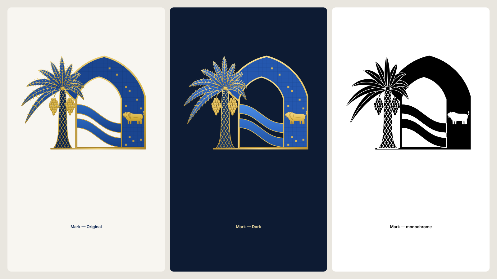

# IQDI_LIGHT_DARK_VARIANTS

## One geometry, two treatments

The Original and Dark files are produced from the **same** `mark_group()` call with a different palette. The unit test `Original and Dark share one geometry` compares every `d=` attribute: same paths, same order. Only the paint differs, so there is one mark, not two.

## What Dark changes (beyond the background)

| Element | Original | Dark | Why |
|---|---|---|---|
| Intended background | Ivory `#F8F6F1` | **Night navy `#0D1B33`**, not flat black | The request: «كحلياً ليلياً بدلاً من أسود مسطح» |
| Gold | `#E9CB72 → #A9842C` | `#F5DC8E → #BC9334` (brighter) | Gold details stay legible on navy |
| Tiles | `#1A4590` | `#2457AE` (lighter) | The arch body separates from the night background; the gold frame carries the outline |
| Rivers | Same tone for both bands | **Two different tones** (`#4A8BE3` and `#3471CD`), both lighter | Stronger contrast between the rivers; they never merge |
| Trunk | Navy `#0B2450` | `#183766` | The trunk would disappear into the background |
| Inner arch detail | Gold frame on ivory | Brighter gold frame on navy; the opening shows the night background | The opening keeps its shape |
| Shadows | None | None. No black shadows were added | «تخفيف الظلال السوداء العميقة» |
| «IQDI» | Navy with a gold rim | **Gold gradient** with a light-gold rim | Navy letters vanish on navy |
| Arabic name / tagline | Navy | Pale gold `#EBD9A0` / `#D9C48A` (12.3 : 1 and 10 : 1) | Readable |
| Gloss | Subtle gradients | Subtle gradients, no specular highlights | «عدم استخدام لمعان مبالغ فيه» |

## Each variant checked on its own background

- **Original on ivory:** `images/logo-variants.png`, first panel. Both rivers are separate and the opening is clean.
- **Dark on night navy:** second panel. The rivers are distinct, the arch frame and opening are readable, and the wordmark is legible.
- **In the apps:** the browser check `scripts/brand-check.mjs` switches the live theme and confirms the artwork changes from `iqdi-*-original` to `iqdi-*-dark` with the same accessible name. It does this on the wallet welcome screen, the wallet settings and the verifier settings, at 390 px.

## Monochrome

- `iqdi-mark-monochrome.svg` and `iqdi-logo-monochrome.svg` use one colour, `currentColor`, with knock-outs made by an SVG mask:
  - the trunk weave;
  - the frond midribs;
  - a halo around the palm and rivers;
  - the lion as a negative silhouette.
- They have no gradients.
- They are rendered black on white and white on black in `images/logo-variants.png`, panels 3 and 4.
