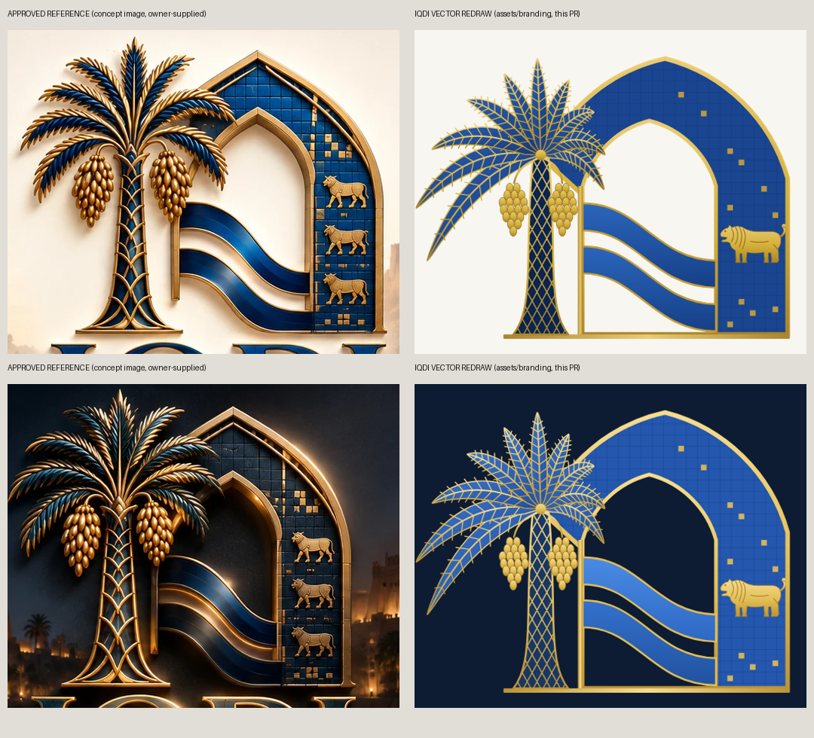

# IQDI_LOGO_REFINEMENT_REPORT

## Source of truth

The owner-approved concept image («النسخة الأصلية / Original» and «النسخة الداكنة / Dark»), supplied with the request. Crops are in `images/reference-*-crop.png`.

That image is a rendered concept. It has 3-D lighting, a landscape backdrop and three lions, so it cannot be used as a logo file. The masters in `assets/branding/` are a **geometric vector redraw** of its composition.

**What the redraw is not:**
- not a trace;
- not a different design;
- not one of the earlier random proposals.

**Kept from the reference:**
- the palm on the left, in front of the arch;
- the pointed Ishtar-gate arch with a gold frame and blue tiles;
- the opening on the palm side;
- two rivers flowing from a gold post into a tiled right band;
- a gold base;
- a navy serif «IQDI» with a gold rim;
- the Arabic name and the spaced English tagline.

## Requested refinements and what was done

| # | Request | Done | Where it is checked |
|---|---|---|---|
| A1 | Keep the palm as the main element | Yes. It is the tallest element, at the front, in gold and blue | Visual |
| A2 | Date clusters about 20–25 % smaller | Yes. Each cluster is about 78 × 141 units against about 110 × 190 in the reference: about 71–74 % of its width and height, i.e. about 25 % smaller | Generator `date_cluster()`; test: 2 clusters × 19 dates |
| A3 | Two balanced clusters | Yes. They are mirrored about the trunk on equal stems | Visual, test |
| A4 | Simplify the frond detail | Yes. 10 fronds with 9 leaflet ticks per side, instead of the reference's dense serration | Visual |
| A5 | The palm must not cover the arch opening or overpower the D shape | The right-hand fronds stop at x ≈ 505, while the opening starts at x 446–462 at that height. Only the outer edge of the frame is overlapped, which is also true in the reference | Geometry |
| A6 | Keep it recognisably an Iraqi date palm | Yes: feathered, drooping pinnate fronds, a woven trunk and hanging date clusters, not a generic fan palm | Visual |
| B1 | Keep the approved arch shape | Yes: pointed, gold-framed, with the opening on the palm side | Visual |
| B2 | Babylonian-blue tiles in the full mark | Yes: a tile pattern with a grid and a few gold tiles | — |
| B3 | Uniform frame line widths | Yes. Outer frame 12, inner frame 10, rivers' gold edge 5, base and post 12 | Generator constants |
| B4 | Fix asymmetric corners | Yes. Both arches are exact two-centred pointed arches (outer symmetric about x 665, inner about x 623) | Generator `arch_apex()` |
| B5 | Consistent negative space in the opening | Yes. The opening is a real cut-out (even-odd fill), so any background shows through | Test: no fill in the opening |
| B6 | Drop the small tile detail at small sizes | Yes. The app icon and symbol have no tiles or grid | Test |
| C1 | One lion only in the full mark | Yes (the reference shows three) | Test: exactly one lion path per mark and logo |
| C2 | Rebalance the lion's body, head, legs and tail | Redrawn: striding, open jaws, mane strokes, four legs with paws, raised tail with a tuft | Visual |
| C3 | Babylonian-inspired, no archaeological claim | Stated in the generator and in these docs. It is a simplified drawing, not a copy of a specific glazed-brick panel | — |
| C4 | No lion at 32 px and below | Yes. The symbol and app icon contain no lion | Test |
| D1 | Exactly two rivers | Yes | Test: two bands and no third band path |
| D2 | Balanced thickness | Both bands are 72 units thick | Geometry |
| D3 | Clean meeting points | Both start flush on the gold post and end flush on the band divider | Visual |
| D4 | No third wave from shadows or metal edges | No shadows or highlight strokes at all. The gold edge is a single 5-unit stroke | Visual, test |
| D5 | Flow from the palm towards the arch | Yes, left to right with a downward S-curve | Visual |
| D6 | The rivers must not close the opening | The opening stays clear above the upper river (y 224–446) and between the bands (a 42–44 unit gap) | Geometry |
| D7 | Light and Dark tested separately | Yes. In Dark the two bands get different tones (`#4A8BE3` and `#3471CD`) so they never merge on night navy | `IQDI_LIGHT_DARK_VARIANTS.md` |
| E | A real Dark treatment, not just another background | Night navy instead of black; brighter gold; lighter trunk; separated river tones; a gold wordmark for readability; no black shadows; no extra gloss | `IQDI_LIGHT_DARK_VARIANTS.md`, test |
| E* | Same geometry in both | Yes. The path data is identical and in the same order | Test |
| F1 | Always spell «IQDI» | Yes. «IQDI» is outlined from Cinzel Bold | Test (no live text) |
| F2 | Modern, sober type with tuned spacing | Cinzel is a modern, open-licence inscriptional serif, close to the reference letterforms. Tracking +0.03 em on «IQDI», +0.32 em on the tagline. The lines are spaced so the Q's tail never touches the Arabic | Visual |
| F3 | Correct Arabic name | «الهوية الرقمية العراقية», shaped with HarfBuzz (correct joining forms) | Visual |
| F4 | No «وزارة» or «جمهورية العراق» | None in any asset | Test |

## Decisions where the reference was ambiguous

1. **The arch's left leg** is hidden behind the palm in the reference. In the redraw the outer arch's left flank ends under the crown and runs diagonally into the gold post. That avoids a stray tile ledge visible between the fronds.
2. **Where the rivers end:** the reference rivers disappear into the tile band at different heights. Both now end on the band divider, which keeps their thickness equal.
3. **The wordmark in Dark:** the reference's dark-navy letters with a gold rim almost vanish on a night background. A gold gradient fill with a light-gold rim was chosen instead, as the request («إعادة موازنة لون الكلمة IQDI») allows.
4. **The tagline font:** the reference uses spaced Roman caps, so Cinzel Regular was used.

## Honest differences from the reference

- The vector palm crown is **lighter and less dense** than the reference's sculpted 3-D crown. Its fronds read as separate blades.
- There is no metallic lighting, bevel or relief. Gradients are subtle by design, so the mark survives scaling and printing.
- The lion is a **simplified stylised drawing**. It is recognisable as a striding lion at mark size, but it is not as detailed as the reference's relief.
- The tile blue was set from the reference's deep cobalt after an eye comparison. It is not a measured colour match; see `IQDI_DESIGN_TOKENS.md`.

These differences come from turning a rendered concept into clean, scalable vector artwork. They are disclosed rather than hidden. No claim is made that the redraw is identical to the reference.
