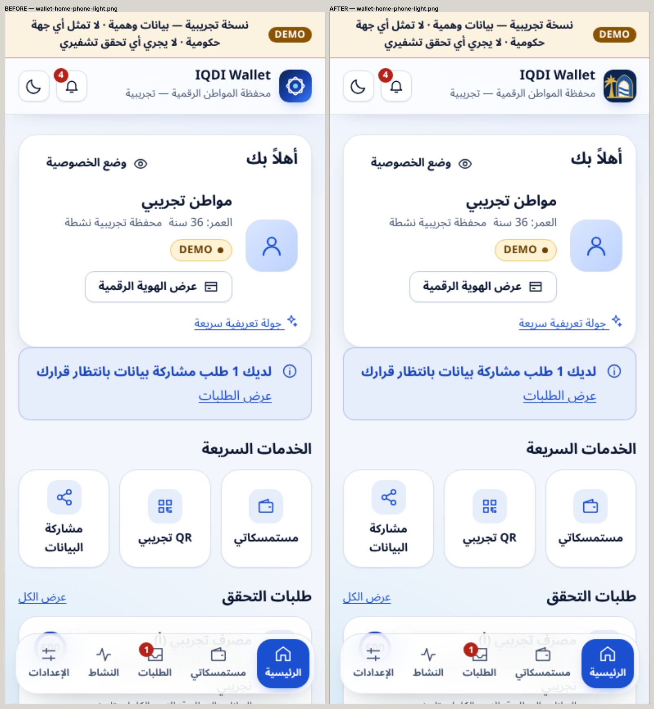
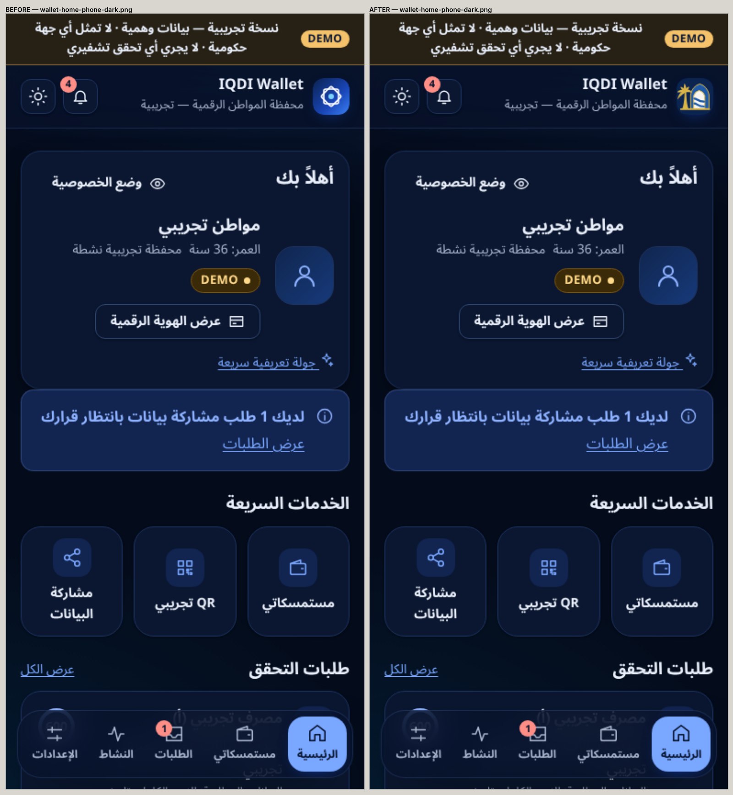
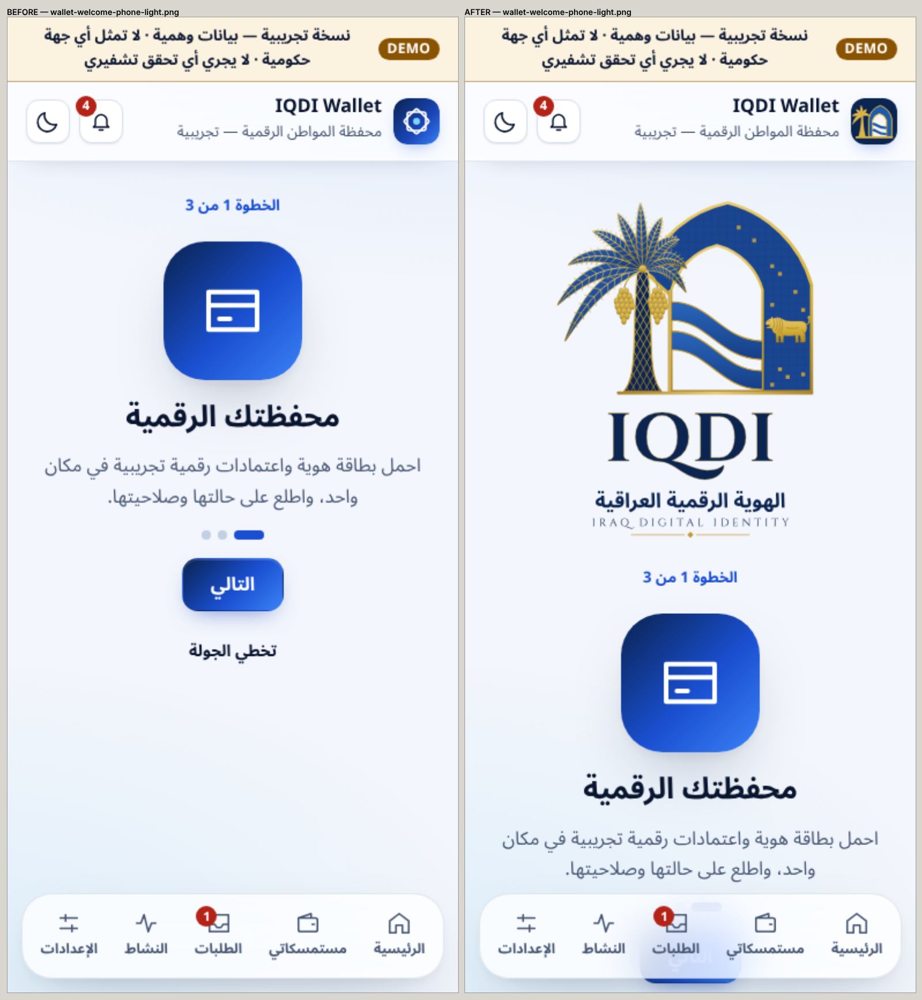
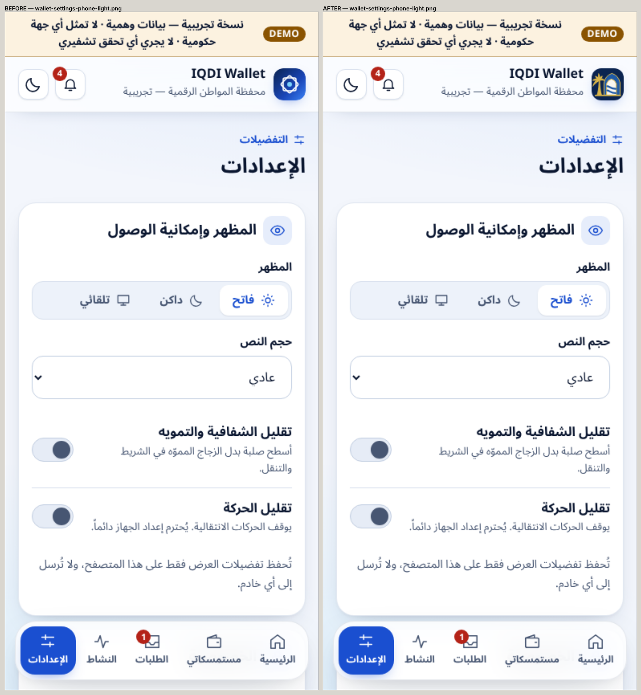
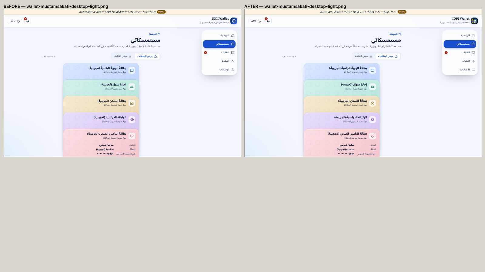
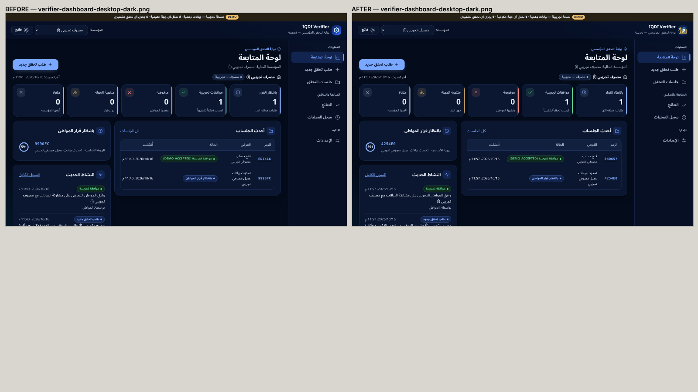
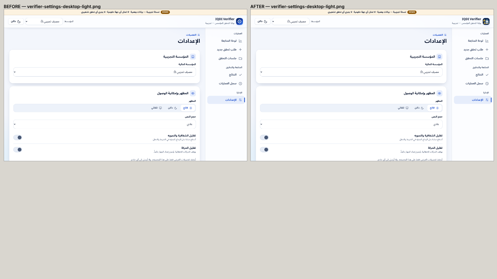
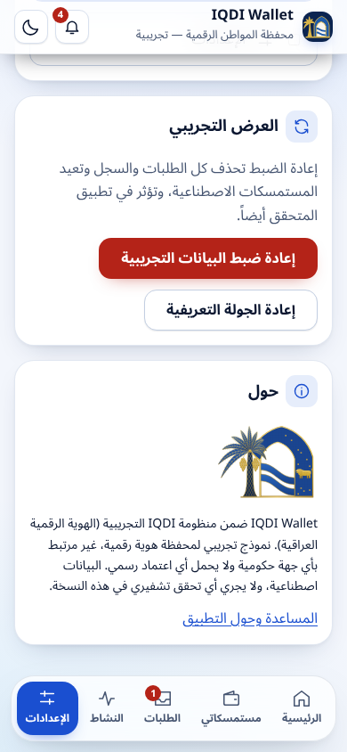
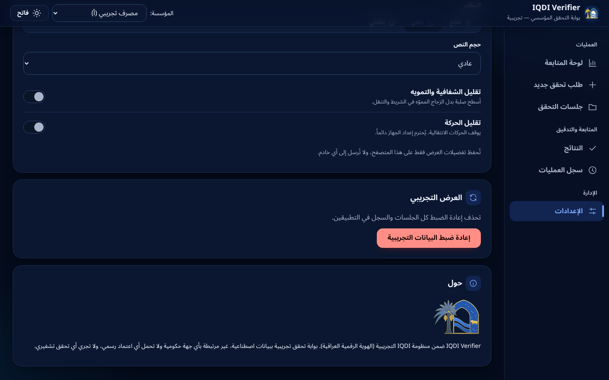

# IQDI_VISUAL_REGRESSION

## Method

**Real screenshots of the production builds** (Chromium, demo API, synthetic data) were taken by `scripts/brand-visual.mjs`:
- **before** the branding change, on the TASK-13 green commit `9a5a137`;
- **after** it, on this branch.

They were paired into side-by-side sheets with `node scripts/brand-visual.mjs --compare`. These are the apps as rendered, not the AI-generated concept image.

**Storage:**
- **Raw captures** (`evidence/branding/visual/before`: 23; `after`: 29, including the 6 About-card captures) are git-ignored like earlier tasks' screenshots. They are delivered in the review package.
- **Comparison sheets for the key screens** are committed under `images/compare/`.

## Screens

| Screen | Views | Themes |
|---|---|---|
| Wallet home | phone 390, tablet 820, desktop 1440 | light, dark |
| Wallet «مستمسكاتي» (`/cards`) | phone, desktop | light |
| Wallet credential detail | phone | light |
| Wallet requests | phone | light |
| Wallet request review (consent) | phone | light, dark |
| Wallet welcome (`/welcome`) | phone | light |
| Wallet settings | phone | light |
| Verifier dashboard | desktop, tablet, phone | light, dark |
| Verifier sessions | desktop | light |
| Verifier session detail | desktop | light |
| Verifier settings | desktop | light |

## What changed, and what did not

| Area | Change |
|---|---|
| Header (every screen, both apps) | The generic blue diamond mark became the IQDI symbol (palm + arch + rivers) at the same 40 px size and position. App name, subtitle and actions are unchanged |
| Browser tab | The text favicon became the IQDI app icon |
| Wallet welcome | The IQDI logo (232 px) is added above the first onboarding step |
| Settings (both apps) | «حول» shows the IQDI mark with a prototype / no-government statement |
| Home, «مستمسكاتي», credential detail, requests, request review, verifier dashboard, sessions, session detail | **No change** apart from the header symbol. Layouts, the card stack, consent buttons, tables and status chips are identical |

## Comparison sheets

The new About cards are below the fold, so they were captured **after the change only**, scrolled to the bottom (`*-settings-about-*`, 6 captures):

## Automated layout regression

The screenshots are for human review. The automated guarantees come from:
- the **responsive matrix** (286 checks), unchanged and passing with the brand in place;
- the **brand check** (68 checks): header symbol inside the header and clear of the app name at 320, 768 and 1440 px; logo and marks inside the viewport with no overflow; no broken images on any main route.
