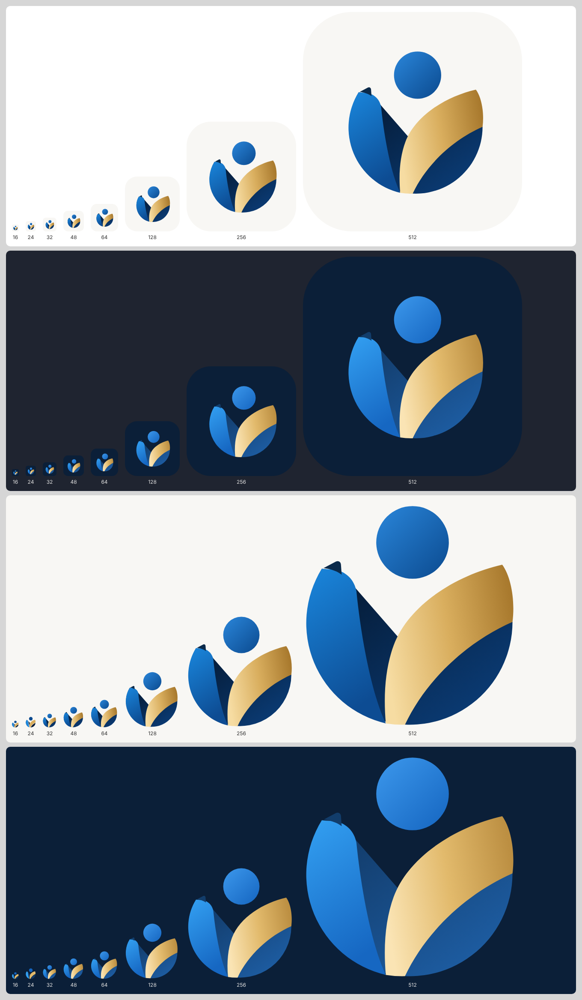
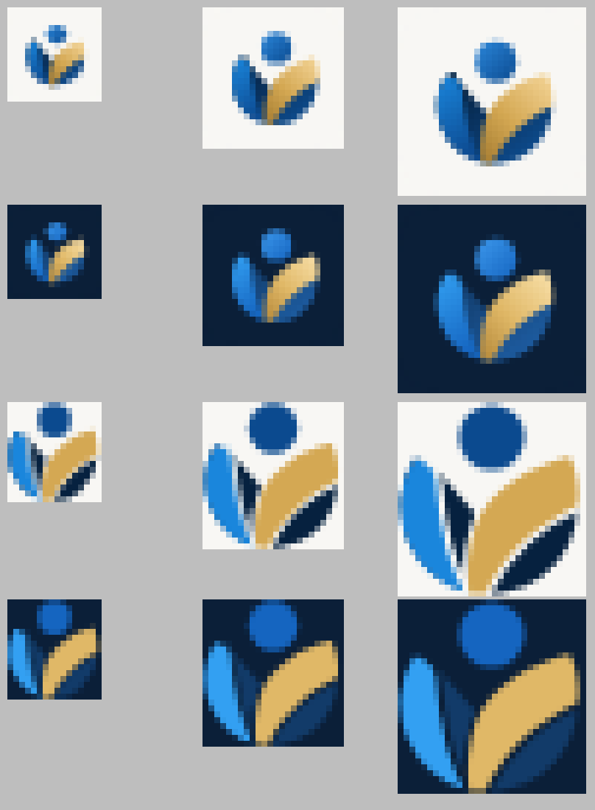

# APP_ICON_SIZE_TESTS

## Method

1. Rendered in Chromium at exact pixel sizes (`deviceScaleFactor 1`) by `scripts/brand-assets.mjs`: 16, 24, 32, 48, 64, 128, 256, 512 and 1024 px (`images/size-ladder.png`).
2. Small sizes (16, 24, 32) enlarged ×8 with nearest-neighbour scaling, so real pixels are judged rather than a smoothed thumbnail (`images/small-sizes-zoomed.png`).
3. Judged by eye against the request's checklist:
   - head clarity;
   - the two curved masses separate;
   - blue not touching gold;
   - no distorted human figure;
   - negative space intact;
   - monochrome meaning;
   - no stray detail.

This is not a user study.

## Results

| Size | App icon (Light) | App icon (Dark) | Compact mark (Light) | Compact mark (Dark) | Verdict |
|---|---|---|---|---|---|
| 1024–128 | Clear: all pieces, the fold, gradients | Clear | (not used) | (not used) | Good |
| 64, 48 | Clear | Clear | Clear | Clear | Good |
| 32 | Head, band, gold and V clear; the fold blurs | Same | Clear, wider gaps | Clear; navy pieces faint on night navy | **Acceptable** |
| 24 | Small inside the tile; head and gold readable | Same | Head, blue, gold and V readable | Blue, gold and head readable; navy merges with the background | **Borderline**: the meaning holds |
| 16 | Symbol too small inside the tile (≈ 10 px) | Same | **Silhouette:** head + blue + gold distinguishable | Head + blue + gold | **Silhouette only** |

**Decision taken from this test:** the **favicon** does not use the app icon. At 16 px the app icon's tile padding leaves the symbol about 10 px wide. The favicon uses the **compact mark on a tight tile** (`iqdi-favicon.svg`); its 32 px raster was checked at ×8 and shows the head, band, gold and navy distinctly.

**Checklist:**
- **Distorted figure:** none at any size.
- **Blue touching gold:** no; the navy body or the compact mark's gap always sits between them.
- **Stray lines:** none.
- **Seam:** an anti-aliasing seam along the gold edge was found in the first render and **fixed** by routing the navy body's boundary under the gold.

## Delivered icon files

| File | Pixels | Notes |
|---|---|---|
| `apps/wallet-web/public/icons/icon-192.png`, `icon-512.png` | 192, 512 | Manifest `any` (off-white app icon) |
| `apps/wallet-web/public/icons/icon-maskable-512.png` | 512 | Manifest `maskable`: full-bleed off-white, symbol inside the central safe zone (92 px padding = 18 %) |
| `apps/wallet-web/public/icons/apple-touch-icon.png` | 180 | iOS home screen: **NOT tested on a device** |
| `apps/{wallet,verifier}-web/public/favicon.svg`, `favicon-32.png` | vector, 32 | Browser tab |
| `assets/branding/people-first/png/iqdi-app-icon-{light,dark}-{16…1024}.png` | 9 sizes each | Other platforms |

`scripts/brand-check.mjs` checks the **production builds**:
- the favicons are served with the right type and size;
- every manifest icon's real size matches its declaration;
- a maskable icon exists;
- `theme_color` is `#0B2A4A`;
- the apple-touch icon is 180 × 180.

**NOT RUN:** installing on Android or iOS, real launcher masking, and the Windows or macOS taskbar.
