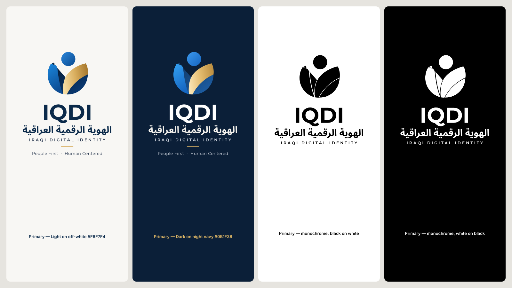
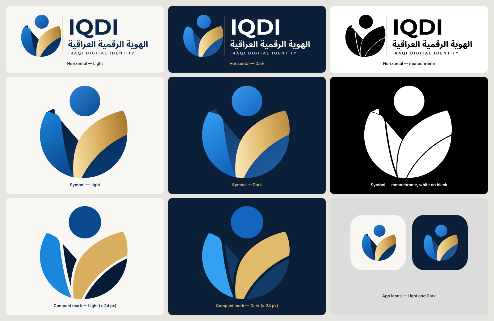

# LIGHT_DARK_AND_MONOCHROME

## One geometry

Light and Dark come from the same generator calls, with only the palette changed. The test `Light and Dark share one geometry` compares every `d=` path, in order, for:
- the symbol;
- the primary logo;
- the horizontal lockup;
- the app icon;
- the compact mark.

## Palettes

| Element | Light (on off-white `#F8F7F4`) | Dark (on night navy `#0B1F38`) |
|---|---|---|
| Head | `#2A86DA → #0B4A8F` | `#3C98EC → #1565C0` (5.4 : 1 vs the background) |
| Blue band | `#1A86DC → #0D4C93` | `#33A0F2 → #1667C2` (5.9 : 1) |
| Fold tab | `#0B2A4A` | `#123D6B` |
| Navy body | `#051B36 → #0B3D78` (16 : 1 vs off-white) | `#123B69 → #1E5FA6`: **lighter** than the background so it does not vanish |
| Gold leaf | cream `#F6DCA2` → `#D9AE5E` → deep gold `#A97A2E` | `#FAE4B4 → #E2BA6C → #BC8F42`: brighter |
| «IQDI» | `#0B2A4A` (13.6 : 1) | `#FFFFFF` (16.6 : 1) |
| Arabic name | `#0B2A4A` | `#F3F1EC` (14.7 : 1) |
| IRAQI DIGITAL IDENTITY / tagline | `#22324A` (12.1 : 1) | `#D9DEE6` (12.3 : 1) |
| Gold rule | `#D4A853` | `#E0B867` |

**Dark is a treatment of its own, not a background swap:**
- the body and band are lighter;
- the gold is brighter;
- the lettering is white or ivory;
- no black shadows;
- no extra gloss.

**Disclosed:** the Dark navy body (`#123B69`) has only **1.46 : 1** against the night background, as in the reference's dark version. The symbol's silhouette is carried by the head (5.4 : 1), the blue band (5.9 : 1) and the gold leaf (8.9 : 1).

## Monochrome

- `currentColor` with an SVG mask; no gradients and no hex colours (test).
- Knock-out gaps keep the four pieces apart:
  - a 14-unit gap around the gold leaf;
  - a 10-unit line on the band's inner edge;
  - a halo around the fold tab.
- The head is separate by construction.
- Rendered black on white and white on black (`images/primary-variants.png`, panels 3 and 4). The meaning (head over two embracing forms) survives in one colour.
- The monochrome primary omits the tagline (single-colour uses are usually small or formal).

## In the apps

`IQDIBrand` selects Light or Dark artwork from the active theme. `scripts/brand-check.mjs` toggles the theme live on:
- the wallet welcome screen;
- the wallet About card;
- the verifier About card.

It confirms the artwork switches to the `-dark` file with the same accessible name.
