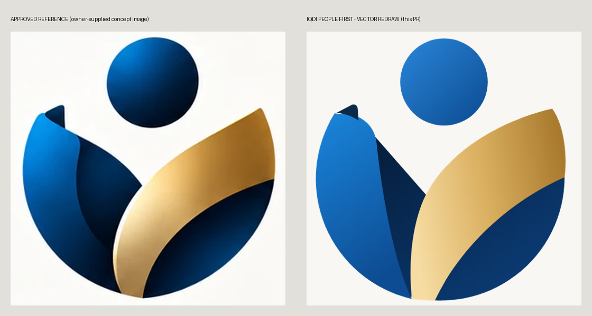

# LOGO_GEOMETRY_AND_ASSETS

## Symbol construction

The symbol sits on a 660 × 660 grid; `SYMBOL_VB = 20 0 640 660`. The geometry is defined once in `tools/branding/people_first.py`.

| Element | Geometry | Meaning |
|---|---|---|
| Head | Circle, centre (340, 120), r 106 | The person |
| Bowl | Circle, centre (332, 352), r 300; the body is cut from it | Inclusion, the system around the citizen |
| Blue band | From the bowl's upper-left point (75, 197) along the circle to the bottom (262, 648), returning on a convex inner curve. Its top folds over (the dark **fold tab**) | Institutions and services, in the reference's royal blue |
| Navy body | Bowl below the open V. Its upper boundary runs *under* the gold leaf, so no seam can show along the gold edge | Stability and trust |
| Gold leaf | From the bottom (262–318, 648–652) to a tip at (602, 185) just outside the bowl. Convex inner edge, concave outer edge | Care and service; the citizen's value |
| V negative space | Between the fold tab, the head and the gold leaf | Openness: the person is not enclosed |

**Optical corrections:**
- The head's bottom (y 226) stays clear of the V and of the gold tip.
- The gold tip rises above the bowl so the right side reads as an upward gesture.
- The compact mark enlarges the head by 6 % (r 112).

The balance is visual rather than mathematical: the blue mass on the left is set against the gold on the right, as in the reference.

## Deviations from the reference (disclosed)

| Reference | Vector redraw | Reason |
|---|---|---|
| 3-D lighting, specular highlights, soft shadows | Flat shapes with controlled linear gradients | Scales, prints and survives small sizes; no raster effects |
| The dark region's upper edge is softly curved | A straight diagonal from the fold to the V | Cleaner negative space; nearly identical silhouette |
| The fold tab is a sculpted ribbon curl | A small flat dark quadrilateral | Keeps the character of the fold without micro-detail |
| No visible gap between the gold and the body | Light and Dark: none. Monochrome and compact: an intentional knock-out gap | Without colour difference, or at ≤ 24 px, the pieces need separation |
| The wordmark font is not named | **Montserrat** (OFL), a geometric sans close to the reference letterforms | Open licence; text outlined |

The redraw keeps the composition, proportions and character. It is **not claimed to be identical**.

## Asset register

All files are in `assets/branding/people-first/`. Every master is a real SVG:
- no embedded raster;
- no script;
- no live text;
- fewer than 40 path elements;
- under 70 KB.
All of this is enforced by tests.

| File | Content | Use |
|---|---|---|
| `iqdi-primary-light.svg` / `-dark.svg` | Symbol + IQDI + «الهوية الرقمية العراقية» + IRAQI DIGITAL IDENTITY + gold rule + «People First • Human Centered» | Welcome screen, presentations, README |
| `iqdi-primary-monochrome.svg` | The same without the tagline, one colour (`currentColor`) | Single-colour print |
| `iqdi-horizontal-{light,dark,monochrome}.svg` | Symbol \| IQDI + Arabic and English names (**no tagline**) | About cards, verifier sidebar, institutional headers |
| `iqdi-symbol-{light,dark}.svg` | The symbol alone | App headers, large placements |
| `iqdi-symbol-monochrome.svg` | One colour, with knock-out gaps | Watermark-free single-colour use |
| `iqdi-symbol-compact.svg` / `-compact-dark.svg` | Same symbol: flat colours, no fold tab, wider gaps | ≤ 24 px |
| `iqdi-app-icon-{light,dark}.svg` | Rounded square (off-white or night navy) + symbol | PWA and app icons |
| `iqdi-favicon.svg` | Tight off-white tile + compact mark | Browser tab (copied to both apps) |
| `png/*.png` (43) | Derived from the masters in Chromium | Platforms that need raster |

**Fonts:**
- Montserrat 700/600/400: `@fontsource/montserrat@5.3.0`, SIL OFL 1.1.
- Noto Sans Arabic 700: an existing dependency, SIL OFL 1.1.
- Both are used as outlines only; no font file is redistributed.
