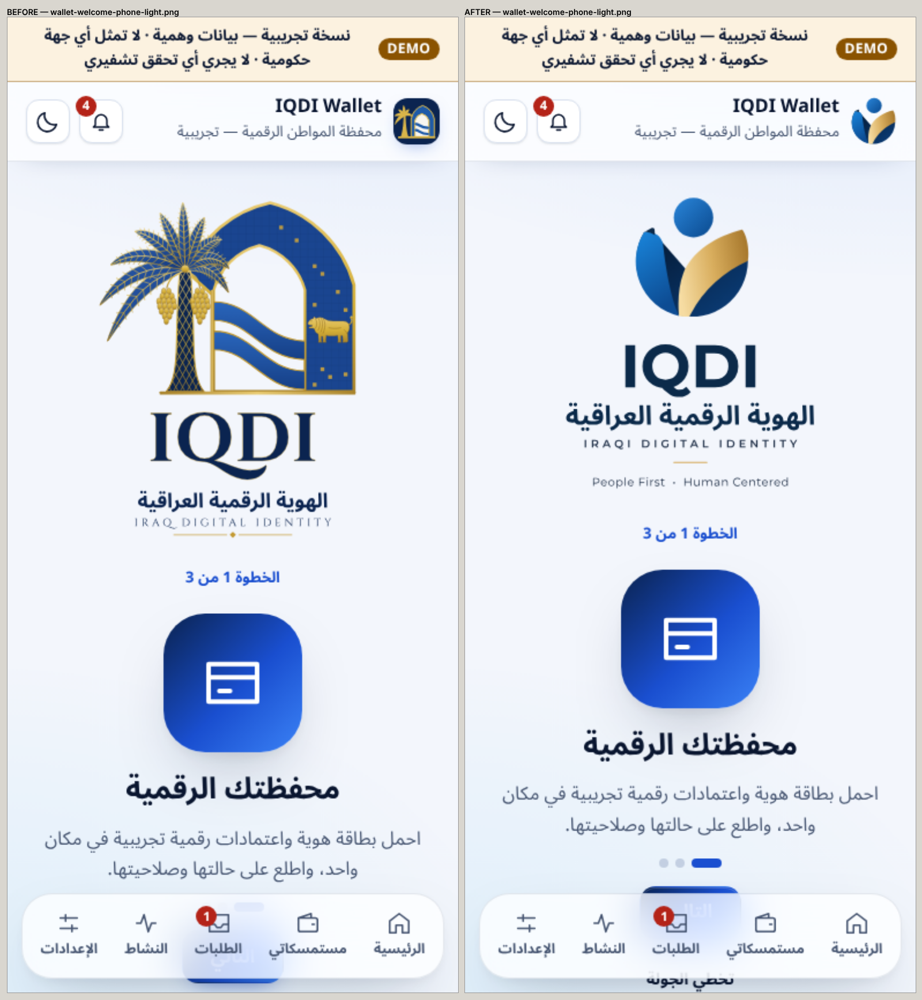
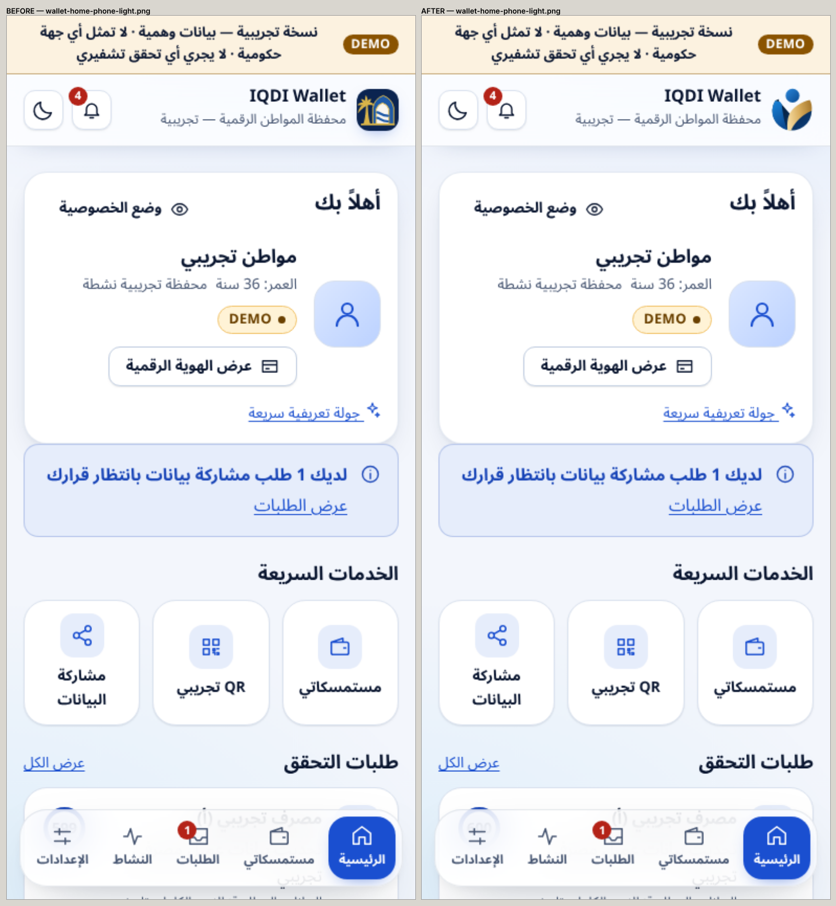
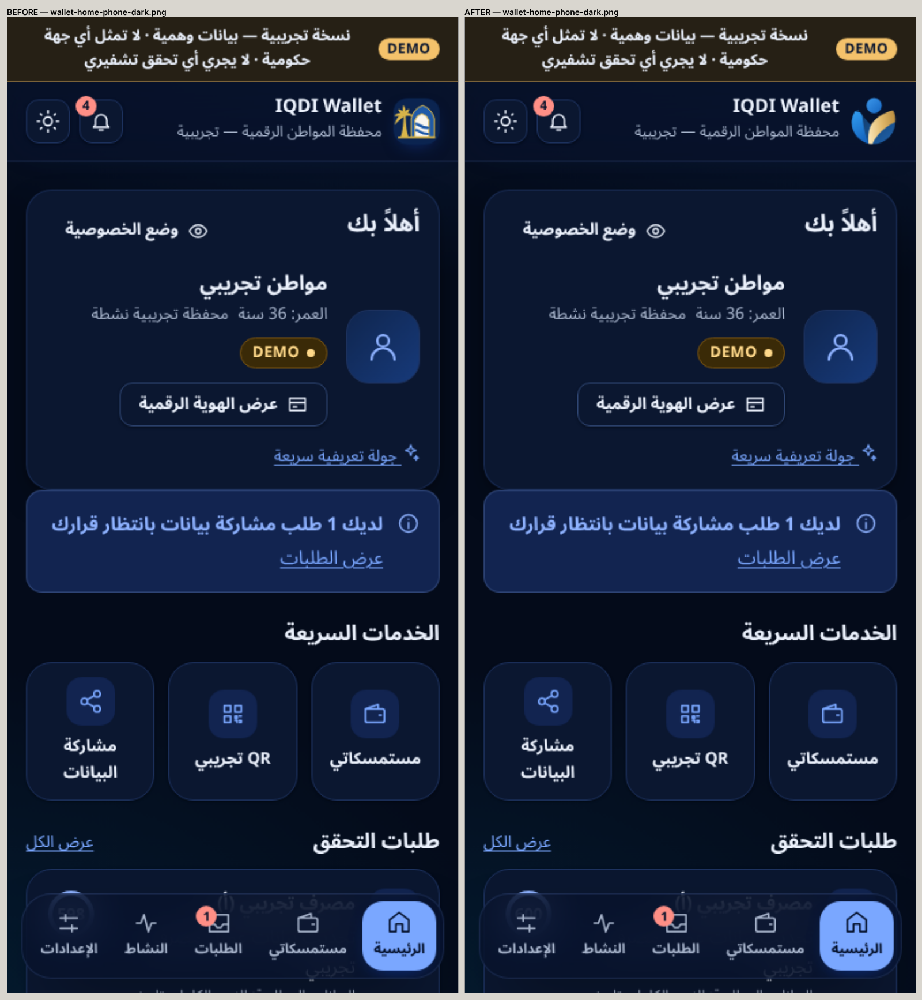
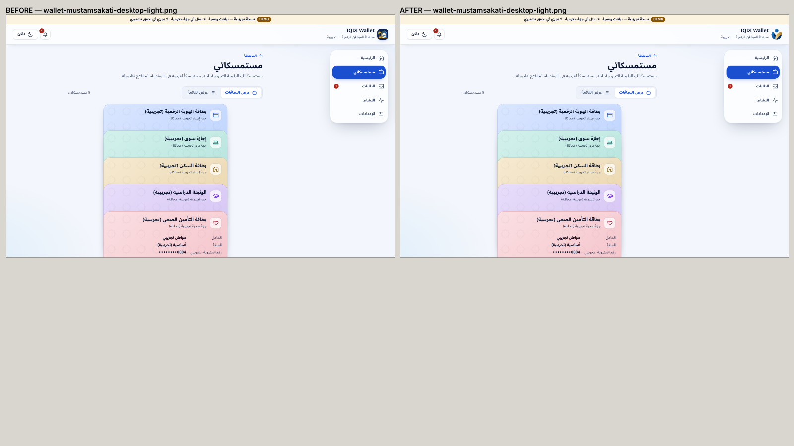
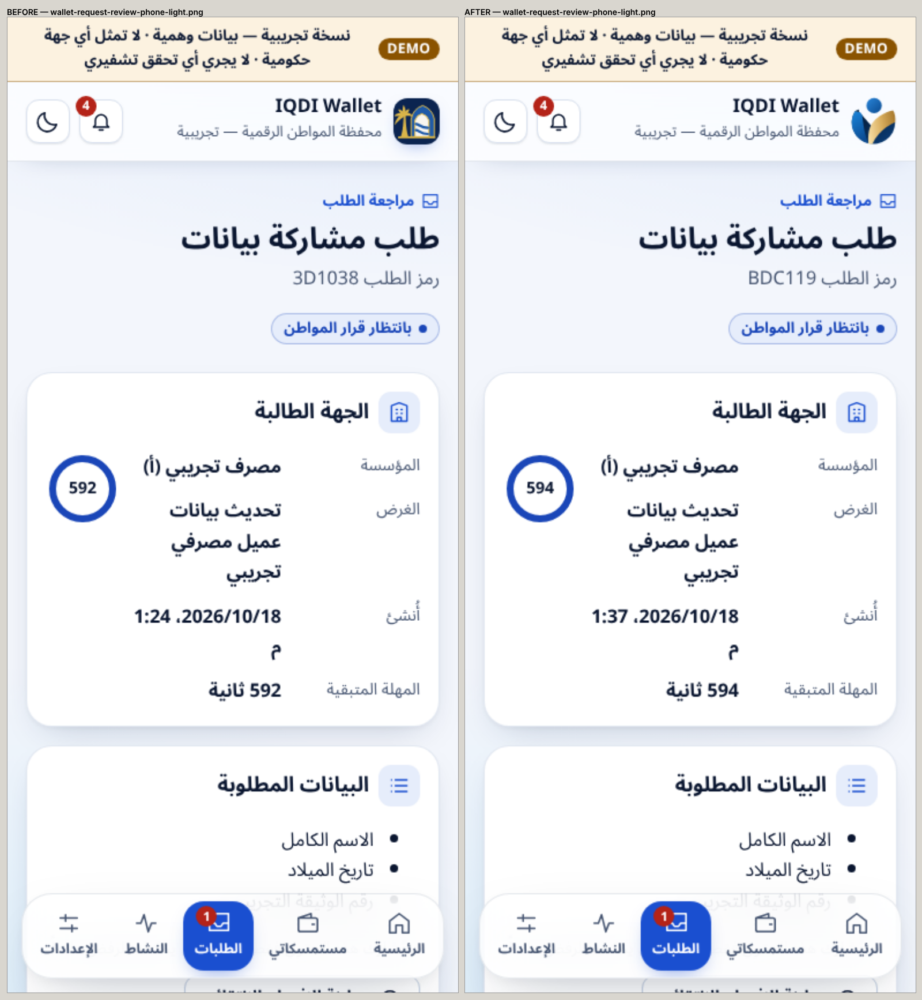
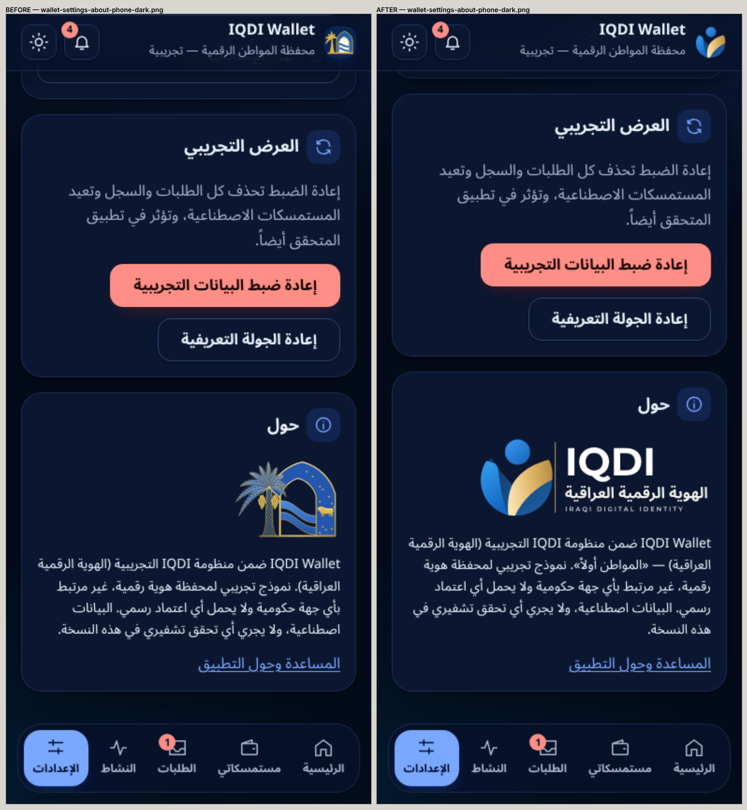
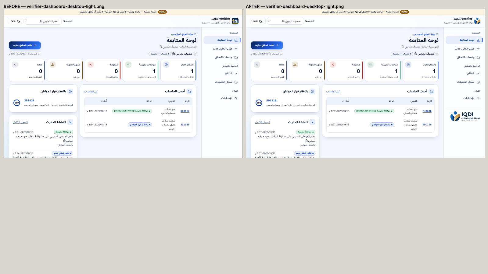
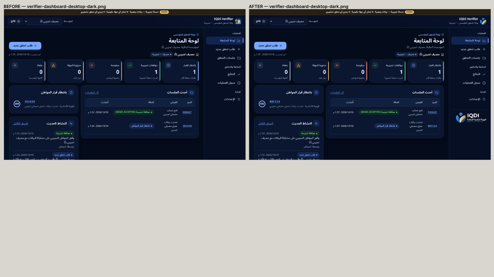
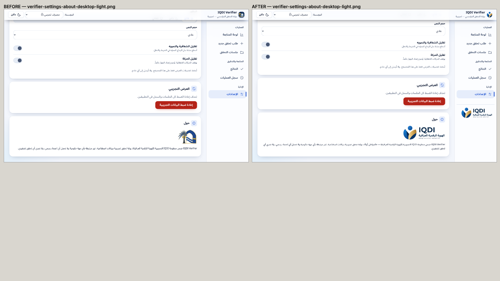

# VISUAL_REGRESSION_EVIDENCE

## Method

**Real screenshots of the running production builds** (Chromium, demo API, synthetic data), taken by `scripts/brand-visual.mjs`:
- **BEFORE:** branch at `fb4ce80`, the palm/arch identity of PR #14.
- **AFTER:** this branch.
- 29 captures each: phone 390, tablet 820 and desktop 1440, in light and dark, including the About cards scrolled into view.

The pairs were combined into side-by-side sheets with `--compare`. No AI-generated image is used as a runtime screenshot. The concept image appears only in `reference-*` files, labelled as the reference.

**Storage:**
- Raw captures (`evidence/branding/people-first/visual/{before,after}`) are git-ignored, like earlier tasks' screenshots, and delivered in the review package.
- The key comparison sheets are committed in `images/compare/`.

## Old brand vs new brand in the apps

## What differs between BEFORE and AFTER

| Area | Difference |
|---|---|
| Header, both apps | The palm/arch tile icon became the transparent People First symbol, at the same size and position |
| Wallet welcome | The palm/arch logo became the People First primary logo |
| About cards | The palm/arch mark became the horizontal lockup |
| Verifier sidebar | Horizontal lockup added under the menu (desktop, tall windows) |
| Everything else | **Identical:** card stack, consent buttons, tables, chips, navigation, spacing |

## Fixes found by looking

1. **Light symbol:** a dark hairline along the gold edge (anti-aliasing seam). Fixed in the geometry.
2. **Verifier sidebar:** a bottom-pinned lockup fell below the window at 1440 × 900, because the sidebar height formula predates the demo banner. The lockup now sits under the menu; it is hidden on windows ≤ 760 px high and on the ≤ 860 px tab-bar layout. A browser check now verifies it is fully visible where shown.
3. **Horizontal lockup:** the Arabic line was wider than the canvas. The canvas is now sized from the widest line.
