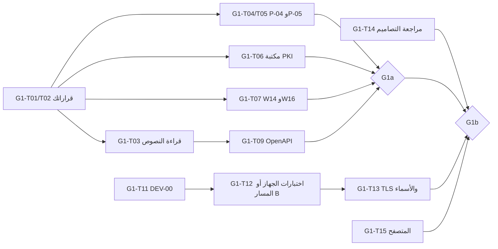

# منظومة الهوية الرقمية الوطنية العراقية — نموذج تجريبي
## خطة إغلاق موانع بوابة G1 — الإصدار 1.0

| البند | القيمة |
|---|---|
| الوثيقة | G1_Blocker_Closure_Plan_v1.0 |
| التاريخ | 11 تشرين الأول 2026 |
| الحالة | `[توصية]`؛ تفترض قبول تجزئة البوابة (DR-60). إن رُفضت يُدمج المعياران في بوابة واحدة |
| المراجع | G1_Decision_Recommendations_v1.0، وDevice_Compatibility_Test_Plan_v1.0 |

---

## 1. حالة الموانع الآن

| المانع | القرار | الحالة الآن | ما يغلقه |
|---|---|---|---|
| RV-01 | DR-01 | قرارك | موافقتك على مستويي الاعتماد |
| RV-02 | DR-09 | جهاز | DEV-00 ثم P-06…P-09 أو اختيار المسار B |
| RV-03 | — | **مغلق** (بنية السجل) | — |
| RV-04 | DR-11، DR-13، DR-14 | جزئي | G1-T03، وW14 |
| RV-05 | DR-15 | جزئي | موافقتك + G1-T06 (X11–X16) |
| RV-06 | DR-12 | جزئي | موافقتك + P-04 |
| RV-07 | DR-02…DR-08 | قرارك | الدفعة أ + DR-06 |
| RV-08 | DR-59 | جزئي | مراجعتك للمواصفات 1.1 |
| RV-09 | DR-60 | يتوقف على الباقي | موافقتك على التجزئة |
| RV-10 | DR-18، DR-19 | قرارك | موافقتك |
| RV-11 | DR-17 | جزئي | موافقتك + P-05 |
| RV-12 | DR-06، DR-08 | جهاز | P-13، P-17، P-18 |
| **RV-32 (جديد)** | DR-14، DR-61 | مفتوح | تعارض DR-14 مع HAIP: يُغلق بقرارك على DR-14 المعدّل وDR-61 |
| **RV-33 (جديد)** | DR-51 | مفتوح | تصادم `UT` و`R`: يُغلق بموافقتك على تعديل DR-51 |
| **RV-34 (جديد)** | DR-59 | مفتوح | تعارض عدد اللوحات (8/7/12/11): يُغلق بالجرد الجديد وعدّ اللوحات في الصورتين |

> RV-32 إلى RV-34 اقتراح بإضافة مشكلات جديدة إلى سجل المراجعة، وليست مضافة إليه بعد.

---

## 2. المهام

**المالك:** «أنت» = صاحب المشروع؛ «الفريق» = العمل الهندسي (المساعد) بعد إذنك.

| المهمة | الوصف | المالك | يعتمد على | الدليل المطلوب للإغلاق | البوابة |
|---|---|---|---|---|---|
| G1-T01 | الموافقة على الدفعة أ من القرارات | أنت | — | عبارة موافقة مسجلة في سجل القرارات | G1a |
| G1-T02 | القرارات الصريحة: DR-01، 14، 18، 19، 22، 52، 58، 60، 61 | أنت | — | قرار لكل بند | G1a |
| G1-T03 | قراءة النصوص النهائية وجدول الحقول السبعة عشر [غ] | الفريق | — | جدول: الحقل، والنص، والقسم، والرابط، والحكم | G1a |
| G1-T04 | P-04: أمثلة مسودة SD-JWT VC ‎-19 بالمكتبات | الفريق | G1-T01 | سكربت ونتائج خام وتجزئة الإصدارات | G1a |
| G1-T05 | P-05: قواعد قائمة الحالة (`sub`=`uri`، `exp`، `ttl`، خارج الحدود، `bits=2`) | الفريق | G1-T01 | كما سبق | G1a |
| G1-T06 | اختيار مكتبة تحقق مسارات PKI وتشغيل X01–X09 وX11–X16 بها | الفريق | DR-15 | تقرير مقارنة مكتبتين على الأقل + نتائج خام | G1a |
| G1-T07 | W14 (`x509_hash`) وW16 (مضيف `response_uri` غير مسجل) | الفريق | DR-14 | نتائج خام | G1a |
| G1-T08 | تحديث قوالب الوثائق: تطبيق القرارات المعتمدة على الفصول (تصويبات v1.2 بمعرّفات ER-06…) | الفريق | G1-T01، G1-T02 | وثيقة تصويبات وفرق النصوص | G1a |
| G1-T09 | ملف OpenAPI للخدمات الخلفية (OAS-01…OAS-08) — **مواصفة لا شيفرة** | الفريق | G1-T03 | ملفات OpenAPI مراجعة | G1a |
| G1-T10 | تشغيل بيني مع تنفيذ مستقل لأحد البروتوكولين (اختياري لرفع الثقة) | الفريق | G1-T01 | سجل تبادل | — (يُنصح به قبل G1b) |
| G1-T11 | DEV-00: تحديد طراز MatePad ونظامه | أنت (بخطوات مكتوبة) | — | لقطة شاشة «حول الجهاز» + مخرجات الأوامر | G1b |
| G1-T12 | اختبارات الجهاز للمسار A أو قرار المسار B | الفريق + أنت | G1-T11 | سجلات P-06…P-09 وP-14…P-19 | G1b |
| G1-T13 | P-13 وP-17 وP-18: TLS والأسماء والوقت على الجهاز المعتمد | الفريق + أنت | G1-T11، DR-06 | لقطات واتصالات ناجحة وفاشلة متوقعة | G1b |
| G1-T14 | مراجعة المواصفات 1.1 ونظام التصميم، وإنتاج صور SW-06 وSV-03 وSV-04 | أنت ثم الفريق | — | صور معنونة بمعرّفات SW/SV + ملاحظاتك | G1b |
| G1-T15 | P-11: المتحقق في المتصفح وقراءة QR من كاميرا الجهاز | الفريق | DR-10 | سجل | G1b |
| G1-T16 | إعادة مراجعة G1a ثم G1b | الفريق | ما سبق | تقرير مراجعة | — |

---

## 3. معايير البوابتين

### G1a — بدء الخدمات الخلفية (C3 وC4 وC5 وC2-B)

| المعيار | الشرط |
|---|---|
| G1a-1 | اعتماد DR-01 (المستوى 1 على الأقل)، وDR-58، وDR-60 |
| G1a-2 | اعتماد DR-12، وDR-14، وDR-15، وDR-17، وDR-18، وDR-19، وDR-61 |
| G1a-3 | اعتماد الدفعة أ، أو استثناءات موثقة منها |
| G1a-4 | نتائج G1-T04 وG1-T05 وG1-T06 وG1-T07 منفذة بأدلة خام، أو مسجلة «فاشلة» مع قرار بديل |
| G1a-5 | G1-T03 منجز، ولا حقل [غ] في واجهة خلفية من دون حكم |
| G1a-6 | ملفات OpenAPI مراجعة (G1-T09) |
| G1a-7 | نصوص رموز R ونصوص الخصوصية في واجهات الخدمات معتمدة (جزء من DR-59) |

**ليست شرطاً لـ G1a:** الجهاز، وصور التصاميم، وDR-06 على الجهاز (الخدمات تُختبر محلياً على Windows أولاً).

### G1b — بدء المحفظة وواجهة المتحقق (C1 وC2)

| المعيار | الشرط |
|---|---|
| G1b-1 | G1a مجتاز |
| G1b-2 | DR-09 محسوم بدليل DEV-00؛ ونتائج اختبارات المسار المختار مسجلة |
| G1b-3 | DR-06 مغلق على منصة المسار (P-13 وP-17) |
| G1b-4 | DR-59 معتمد بعد مراجعة الصور الثلاث |
| G1b-5 | DR-52 معتمد بصيغته المعدلة، وشروط القبول المعدّلة للمسار B منشورة إن اختير |
| G1b-6 | DR-10 مغلق (P-11) |

---

## 4. التسلسل الزمني المقترح (دون مدد، لعدم وجود جدول زمني: RK-09)

يمكن البدء بـ G1-T11 (معلومات الجهاز) وG1-T14 (مراجعة التصاميم) فوراً بالتوازي، لأنهما لا يعتمدان على شيء.

---

## 5. ما لا تغلقه هذه الخطة
- المراجعة الأمنية المتخصصة (DR-49): شرط قبل أي عرض خارجي، وليست شرطاً لـ G1.
- السياسات المؤسسية والقانونية (DR-53، DR-55، DR-56).
- أي ادعاء أمان؛ فاجتياز G1 يعني «جاهز للبناء التجريبي»، لا «آمن».
