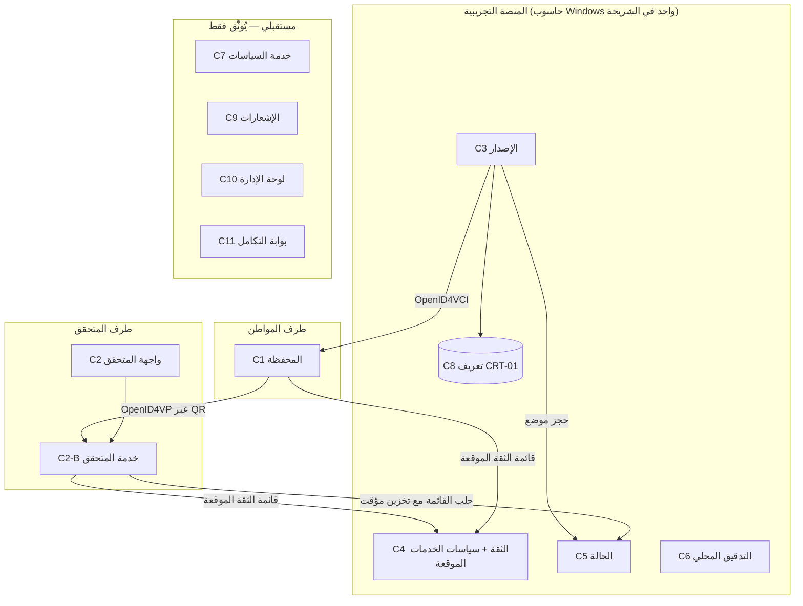

# منظومة الهوية الرقمية الوطنية العراقية — نموذج تجريبي
## المعمارية المحسّنة للمرحلة الثانية — الإصدار 1.2

| البند | القيمة |
|---|---|
| الوثيقة | Phase_2_Enhanced_Architecture_v1.2 |
| التاريخ | 11 تشرين الأول 2026 |
| الحالة | **مسودة مقترحة**؛ لا تُلغي المستند الجامع v1.1 ولا تعدّل قراراته، بل تضيف إليه وتشير إلى ما يحتاج قراراً |
| التصنيف | نموذج تجريبي — بيانات وهمية ومفاتيح اختبارية فقط — لا يمثل أي جهة حكومية |
| المرجع الأساس | Phase_2_Consolidated_Architecture_v1.1 (الفصول 1–19) |

### وسوم الحالة المستعملة في كل وثائق هذه الجولة

| الوسم | المعنى |
|---|---|
| `[معتمد]` | قرار معتمد صراحة من صاحب المشروع. **لا يوجد في المرحلة الثانية قرار بهذا الوسم حتى الآن** |
| `[باستنتاج]` | عُدّ معتمداً بالاستنتاج من موافقة النطاق، وينتظر تأكيداً (OD عبر DR-58) |
| `[توصية]` | توصية من الفريق تنتظر موافقتك؛ ليست موافقة |
| `[منفذ]` | نتيجة اختبار نُفذ فعلاً، مع بيان بيئته وحدوده |
| `[مخطط]` | اختبار معرّف لم يُنفذ |
| `[غير متحقق]` | معلومة لم يُتحقق منها من مصدر أولي أو تجربة |
| `[مستقبلي]` | متطلب خارج الشريحة التجريبية الأولى |

---

## 0. ما الذي تغيّر في هذه الجولة

### 0.1 ما رُوجع فعلاً
- المستند الجامع v1.1 كاملاً من حيث البنية، ومقروءة نصاً: النطاق (1)، والتوافق التقني (3)، ونموذج البيانات (4، الأقسام 0–8)، وشروط بدء التنفيذ (11 §6)، وخطة الاختبار (12 §0–3)، وسجل القرارات (14)، ونتائج البروتوكولين (15)، والتصاميم (16)، والمنصة (17)، والتصويبات (18)، وإعادة المراجعة (19)، والملاحق.
- **ما لم يكن متاحاً:** `Technology_Spike_Scripts_v1.1.zip` (الشيفرة والنتائج الخام)، و`UX_Wireframes_Wallet_v1.0.png` و`UX_Wireframes_Verifier_v1.0.png`، ووثائق المرحلة الأولى (المستند الجامع v1.1 للمرحلة الأولى، وSystem_Architecture_v1.0، وTechnology_Decisions_v1.0). **لذلك لم أُعِد تشغيل أي اختبار من V وW وX، ولم أعاين الصور، ولم أتحقق من نصوص FR/NFR/AC/M الأصلية**؛ وأتعامل معها بحسب ما نقلته وثائق المرحلة الثانية.

### 0.2 ما نُفذ فعلاً في هذه الجولة `[منفذ]`

| الرمز | ما نُفذ | النتيجة | الحدود |
|---|---|---|---|
| EV-01 | قراءة النص المنشور لـ HAIP 1.0 Final من موقع OpenID (11 تشرين الأول 2026) | الملاحظات في §3 أدناه | قراءة نص؛ لا اختبار |
| EV-02 | التحقق من حالة المواصفات في IETF Datatracker | RFC 9901 منشور (تشرين الثاني 2025)؛ SD-JWT VC آخر مسودة ‎-19 (31 آب 2026)؛ Token Status List ‎-21 (21 حزيران 2026) في «RFC Ed Queue» | لم أجد رقم RFC لقائمة الحالة حتى تاريخه `[غير متحقق]` |
| EV-03 | فحص سجل npm للإصدارات المثبتة | تأكد أن 0.22.0 و0.7.0 و0.4.2 و4.0.0 و6.2.12 هي الأحدث؛ و`@openid4vc/*` 0.7.0 و`@sd-jwt/*` 0.22.0 نُشرت **9 تشرين الأول 2026** (قبل يومين) | معلومات السجل فقط |
| EV-04 | قراءة ساكنة لشيفرة `@openid4vc/openid4vp@0.7.0` (الملف `dist/index.mjs`) | تدعم البادئات `x509_hash` و`x509_san_dns` و`x509_san_uri`؛ وتدعم `direct_post.jwt` (ECDH-ES وA128GCM/A256GCM)؛ وترفض الطلب الموقّع مع بادئة `redirect_uri`؛ **والتحقق من سلسلة x5c حتى مرساة الثقة غير موجود في المكتبة بل مفوَّض إلى دالة `verifyJwt` التي يكتبها التطبيق** | قراءة شيفرة، **ليست اختبار تشغيل** |

---

## 1. المنظومة الكاملة: المكونات وحدود الشريحة

> القاعدة: كل مكوّن موسوم إما **شريحة** (يُبنى في الشريحة العمودية الأولى بعد اجتياز البوابة) أو `[مستقبلي]` (يُوثَّق فقط).

| الرمز | المكوّن | المسؤولية | الشريحة؟ | مرجع |
|---|---|---|---|---|
| C1 | تطبيق المواطن (المحفظة) | الاستلام، والتخزين المشفر، والموافقة حقلاً حقلاً، والعرض، والقفل، والسجل المحلي | شريحة (منصتها معلقة على DR-09) | الفصل 2 |
| C2 | تطبيق المتحقق (واجهة) + C2-B خدمته الخلفية | اختيار الخدمة، وإنشاء الطلب الموقع، واستقبال العرض، والتحقق الكامل | شريحة (التقسيم DR-02) | الفصل 2 |
| C3 | خدمة الإصدار | سجل وهمي، واشتقاق الادعاءات، والإصدار بـ ES256، وحجز موضع الحالة | شريحة | الفصل 9 |
| C4 | خدمة الثقة | مرساة اختبارية، وتسجيل المصدِّرين والمتحققين، وقائمة ثقة موقّعة | شريحة (مصغرة) | الفصل 7 |
| C5 | خدمة الحالة | رموز قائمة الحالة الموقعة | شريحة (مصغرة) | الفصل 9 |
| C6 | خدمة التدقيق | سجل غير قابل للتعديل الصامت | محلي في الشريحة؛ المركزي `[مستقبلي]` (DR-43) | الفصل 9 |
| **C7** | **خدمة السياسات والصلاحيات** (جديد) | سياسة كل خدمة تحقق: الغرض، والأساس، والأنواع والحقول المسموحة، والاحتفاظ؛ وتوليد DCQL منها | **جزء منها في الشريحة**: سياسة ثابتة موقعة داخل قائمة الثقة؛ والخدمة المستقلة `[مستقبلي]` | §4 |
| **C8** | **سجل أنواع الشهادات وقواميس البيانات** (جديد) | تعريف كل `vct`: الحقول، والإلزام، والحساسية، وقواعد التحقق، والصلاحية | ملف تعريف ثابت لـ CRT-01 فقط في الشريحة؛ السجل `[مستقبلي]` | National_Credential_Catalog_v1.0 |
| C9 | خدمة الإشعارات | تنبيه قرب الانتهاء، وتغيّر الحالة | `[مستقبلي]`؛ في الشريحة تنبيهات محلية فقط من `exp` | — |
| C10 | لوحة الإدارة | الجهات والخدمات والصلاحيات والأنواع والسياسات والمراقبة والتدقيق | `[مستقبلي]` (DR-57)؛ مواصفات شاشات فقط | Screen_Specifications §5 |
| C11 | بوابة التكامل المؤسسي | واجهات مستقبلية مع مصادر بيانات رسمية | `[مستقبلي]`؛ لا اتصال بأي نظام حقيقي | §6 |
| C12 | مركز الخدمات (في تطبيق المواطن) | قائمة خدمات مستقبلية تطلب شهادات | `[مستقبلي]`؛ شاشة «قريباً» بلا خدمات حقيقية | Product_Vision |

### 1.1 مخطط طبقي مختصر



---

## 2. ملف البروتوكول للشريحة (Slice Protocol Profile)

جدول واحد يجمع اختيارات الشريحة. **كل سطر فيه يحيل إلى قراره؛ ولا يُعدّ السطر معتمداً قبل اعتماد القرار.**

| المجال | اختيار الشريحة المقترح | القرار | الدليل |
|---|---|---|---|
| صيغة الشهادة | SD-JWT VC، `typ=dc+sd-jwt`، تسلسل مضغوط، فوق RFC 9901 | DR-12 | T01–T02، X02 `[منفذ — مكتبة]` |
| مسودة SD-JWT VC | ‎-19 (31 آب 2026) | DR-12 | EV-02 |
| مسودة قائمة الحالة | ‎-21 (21 حزيران 2026)، وترحيل إلى رقم RFC عند صدوره | DR-12 | T22 `[منفذ — مكتبة]` |
| التوقيع | ES256 (ECDSA بمنحنى P-256 وSHA-256، توقيع R‖S بطول 64 بايتاً) وقائمة سماح صريحة | قرار المرحلة الأولى | T03–T04، T11d |
| الإصدار | OpenID4VCI 1.0، Pre-Authorized Code مع `tx_code`، والعرض بمرجع، ونقطة nonce | OD-08 (DR-58)، DR-40 | V01–V10 `[منفذ — داخل العملية]` |
| رمز الوصول | Bearer بلا DPoP، عمر 5 دقائق | DR-37 | — |
| اكتشاف مفتاح المصدِّر | `x5c` بسلسلة تنتهي إلى مرساة اختبارية مثبتة، دون إدراج المرساة في `x5c` | DR-15 | X01–X09 `[منفذ — منطق مخصص]` |
| تعريف المتحقق | **مقترح معدَّل:** `x509_hash` أساساً، و`x509_san_dns` بديلاً مختبراً | DR-14 (معدّل؛ انظر §3) | W01–W08 لـ `x509_san_dns` فقط؛ `x509_hash` `[مخطط: W14]` |
| الطلب | JAR موقّع عبر `request_uri`، وDCQL، وQR بنمط عبر الأجهزة | OD-09 (DR-58) | W01–W02 |
| الرد | `direct_post` واضح فوق TLS، مع خطة ترقية إلى `direct_post.jwt` | DR-36 | W03؛ المشفر `[مخطط: W15]` |
| ربط الحيازة | KB-JWT بـ `nonce` و`aud` = `client_id` كاملاً مع بادئته، و`iat`، و`sd_hash` | SEC-04 | W06–W07؛ صيغة `aud` من المواصفة `[غير متحقق]` (F-12) |
| الحالة | Token Status List، `bits=2`، ≥ 8192 موضعاً، مفتاح حالة منفصل، و`x5c` في ترويسة الرمز | DR-17 | W09–W10، T22 |
| تخزين مفتاح المحفظة | بالعتاد في المسار A إن ثبت؛ برمجي موسوم TEST في المسار B | DR-09 | لا شيء `[مخطط]` |

---

## 3. الموقع من HAIP 1.0 Final (اكتشاف جوهري جديد)

قرأتُ نص HAIP 1.0 Final المنشور في 24 كانون الأول 2025 (EV-01). الوثائق السابقة لم تقارن الشريحة به إلا في نقطة أرقام المسودات. النتيجة:

| بند HAIP 1.0 | ما يفرضه HAIP | اختيار الشريحة | الفجوة | التعامل المقترح |
|---|---|---|---|---|
| §5: تعريف المتحقق | للطلبات الموقعة **يجب** أن يستعمل المتحقق البادئة `x509_hash`، وتقبلها المحفظة | `x509_san_dns` (DR-14) | **تعارض مباشر** | تعديل توصية DR-14 إلى `x509_hash` أساساً `[توصية]` |
| §5.1: الرد | التشفير **إلزامي** عبر `direct_post.jwt` بـ ECDH-ES على P-256 | `direct_post` واضح (DR-36) | تعارض | يبقى الواضح مقبولاً للشريحة مع إعلان أنها غير مطابقة لـ HAIP، وW15 مخطط |
| §5.1: نمط الجهاز | يجب دعم نفس الجهاز، ويُوصى به ما لم يكن السيناريو حضورياً لا يعتمد على ربط الجلسة | QR عبر الأجهزة | متوافق بشرط السيناريو الحضوري | يُقيَّد QR في الشريحة بالتحقق **الحضوري** صراحة |
| §4: الإصدار | يجب دعم Authorization Code مع PKCE وFAPI2 وDPoP، وإثبات المحفظة، وإثبات المفتاح | Pre-Authorized Code بلا DPoP ولا إثباتات | فجوة واسعة | خارج الشريحة، ويُعلن؛ ويُسجَّل `[مستقبلي]` |
| §6.1.1: مفتاح المصدِّر | `x5c` **إلزامي**، ولا تُدرج المرساة فيه، ولا تكون شهادة التوقيع ذاتية التوقيع | `x5c` (DR-15) | متوافق | يُضاف اختباران X11 وX12 |
| §6.1: رمز قائمة الحالة | يجب أن يحمل `x5c`؛ وموضع فريد غير متوقع لكل شهادة | لم يُذكر `x5c` للقائمة | فجوة صغيرة | تُضاف إلى DR-17 |
| §5: DCQL | إلزامي، مع دعم `trusted_authorities` بنوع `aki` | DCQL دون `trusted_authorities` | فجوة صغيرة | `[مستقبلي]` |
| §9.4: المسودات | يشير إلى SD-JWT VC ‎-13 وToken Status List ‎-14 | ‎-19 و‎-21 | اختلاف معلن سابقاً | لا تدّعي الشريحة مطابقة HAIP |

**القرار المطلوب (جديد): DR-61 — موقع الشريحة من HAIP.** التوصية: «مستلهمة من HAIP، غير مطابقة له»، مع جدول الفجوات أعلاه في كل عرض، واعتماد `x509_hash` و`x5c` الآن لأنهما رخيصان وجوهريان، وتأجيل DPoP وإثباتات المحفظة والمفتاح والتشفير. التفصيل في G1_Decision_Recommendations_v1.0.

---

## 4. آلية «يطلب المتحقق ما تسمح به السياسة فقط»

### 4.1 السلسلة
1. **سجل الأنواع (C8)** يعرّف لكل `vct` حقوله وحساسيتها (National_Credential_Catalog).
2. **سياسة الخدمة** (جزء من قائمة الثقة الموقعة في الشريحة؛ C7 لاحقاً) تحدد لكل متحقق مسجل ولكل خدمة: المعرّف، والغرض بالعربية والإنجليزية، والأساس، والأنواع المقبولة، والحقول **الإلزامية** و**الاختيارية**، ومدة الاحتفاظ المعلنة، وبصمة شهادة المتحقق (`x509_hash`).
3. **خدمة المتحقق (C2-B)** تولّد استعلام DCQL **من السياسة آلياً**؛ ولا يملك الموظف اختيار حقول.
4. **المحفظة** تتحقق، قبل عرض أي شاشة موافقة، من: توقيع الطلب، وبصمة الشهادة مقابل قائمة الثقة، وأن كل حقل في DCQL ضمن سياسة تلك الخدمة. أي حقل خارج السياسة = رفض كامل للطلب دون شاشة موافقة (AC-17).
5. **المواطن** يقرر لكل حقل اختياري؛ والإلزامي إما يُرسَل كله أو يُرفض الطلب.
6. **المتحقق** يتحقق من أن العرض لا يحمل أكثر مما طلب (W13).

### 4.2 البدائل في DCQL
يُستعمل `credential_sets` لقبول أكثر من مصدر للشرط نفسه، مثل: «إثبات تجاوز 18 من CRT-04، **أو** من CRT-01». وتُفضّل السياسة الشهادة الأقل كشفاً (CRT-04) حين تكون متاحة. `[مستقبلي]` لأن الشريحة تصدر CRT-01 فقط.

### 4.3 بنية مقترحة لسياسة خدمة (توضيحية، ليست مخططاً نهائياً)

```json
{
  "service_id": "svc-test-age-check",
  "verifier_x509_hash": "<base64url sha-256 of leaf cert>",
  "purpose": {"ar": "التحقق من بلوغ 18 عاماً لخدمة تجريبية", "en": "Test age check"},
  "legal_basis_ref": "TEST-ONLY",
  "accepted_vct": ["urn:test:iq-digital-id:national-id:1"],
  "required_claims": ["age_over_18"],
  "optional_claims": ["name"],
  "declared_retention": "none",
  "valid_until": "<date>"
}
```

---

## 5. البيانات الوصفية التي تظهر في العرض وأثرها في الخصوصية وقابلية الربط

| العنصر | يظهر للمتحقق؟ | ما يكشفه | قابلية الربط | التخفيف المقترح | في الشريحة |
|---|---|---|---|---|---|
| `vct` | دائماً | نوع الوثيقة («هوية وطنية») حتى لو طُلب العمر فقط | منخفضة بمفرده | شهادة عمر منفصلة CRT-04 | لا (DR-19) |
| `iss` و`x5c` | دائماً | الجهة المصدرة وسلسلة شهاداتها | منخفضة | ثابتة للجهة لا لكل حامل | نعم |
| `iat` و`exp` | دائماً | وقت الإصدار بدقة الثانية | **عالية** مع غيرها | تقريب إلى اليوم أو الأسبوع | لا (DR-28) |
| `status.idx` و`uri` | دائماً | موضع ثابت فريد لكل شهادة | **عالية جداً** | دفعات شهادات أحادية الاستعمال؛ قوائم كبيرة | جزئياً (حجم ≥ 8192) |
| `cnf.jwk` | دائماً | مفتاح المحفظة العام | **عالية جداً** عبر المتحققين | مفتاح مختلف لكل شهادة في دفعة | لا |
| مصفوفة `_sd` | دائماً | عدد الادعاءات المخفية وتجزئاتها الفريدة | **عالية** (التجزئات فريدة) | تجزئات وهمية؛ دفعات | لا (DR-27) |
| توقيع المصدِّر | دائماً | قيمة فريدة لكل شهادة | **عالية** | دفعات أحادية الاستعمال | لا |
| KB-JWT `iat` | دائماً | وقت العرض | منخفضة | — | — |
| عنوان IP | للخادم | موقع تقريبي | متوسطة | سياسة سجلات (DR-53) | سياسة فقط |
| جلب المحفظة لقائمة الحالة | لمستضيف القائمة | نشاط المواطن ووقته | متوسطة | لا تجلب المحفظة القائمة (DR-35) | نعم |
| جلب المتحقق لبيانات المصدِّر | للمصدِّر | وقت الاستعمال | متوسطة | تخزين مؤقت، ولا جلب لكل تحقق (AC-22) | نعم |

**الخلاصة الصريحة:** في الشريحة، كل عرضين من الشهادة نفسها **قابلان للربط** عند أي متحققَين يتعاونان، عبر `cnf` و`status.idx` والتوقيع و`_sd`. هذا ليس عيباً في التنفيذ بل طبيعة SD-JWT دون دفعات. ويجب أن يُعلن في كل عرض للنموذج (PRV-08).

---

## 6. فصل الاختبار عن الإنتاج وإدارة المفاتيح

| الطبقة | النموذج التجريبي | ما يلزم قبل أي إنتاج `[مستقبلي]` |
|---|---|---|
| مرساة الثقة | ملف مشفر غير متصل على حاسوب الاختبار، اسمها يحمل TEST | HSM معتمد، وحفل مفاتيح موثق بشهود، وسياسة شهادات (CP/CPS) |
| مفاتيح المصدِّر والحالة والثقة | ملفات مشفرة، مفتاح لكل غرض (SEC-03) | HSM، وتدوير مجدول، وفصل أدوار |
| مفتاح المحفظة | عتادي إن ثبت (المسار A)، أو برمجي موسوم TEST (المسار B) | عتادي مع إثبات مفتاح (Key Attestation) |
| الأسماء | نطاق `.test` المحجوز | نطاقات مملوكة رسمياً |
| TLS | جهة TLS اختبارية **منفصلة** عن مرساة الاعتمادات (SEC-06) | شهادات Web PKI عامة |
| البيانات | وهمية، ورقم يبدأ بـ `TEST-` | مصدر رسمي بأساس قانوني |
| التكامل (C11) | لا يوجد | اتفاقات تكامل ومراجعة قانونية |

**ضابط رمزي يُعتمد:** كل مفتاح وشهادة وواجهة وشاشة تحمل علامة TEST، ويرفض أي مكوّن تجريبي أي شهادة أو مفتاح لا يحمل هذه العلامة. وهذا ضابط ضد الخلط، وليس ضابطاً أمنياً.

**قاعدة التحقق من X.509:** منطق السلسلة الذي كُتب في الاختبار (X01–X10) **ممنوع في أي شيفرة نظام**. يُستبدل بمكتبة تحقق مسارات PKI موثوقة تُختار في المهمة G1-T06، مع اختبارات X11–X16 (الملحق أ)، ثم مراجعة مختص قبل أي عرض خارجي (DR-49).

---

## 7. تسلسل التحقق المعياري لدى المتحقق (ترتيب ملزم مقترح)

1. الجلسة موجودة وغير منتهية، ولم تستقبل رداً سابقاً (W04).
2. `state` يطابق الجلسة.
3. التحليل البنيوي للعرض (حدود الحجم وعدد الإفصاحات).
4. `typ=dc+sd-jwt` و`alg` ضمن قائمة السماح (ES256 وحدها).
5. سلسلة `x5c` → مرساة الاختبار بمكتبة PKI (X01–X16).
6. شهادة الورقة مسموحة لهذا `iss` و`vct` في قائمة الثقة (TS-T06).
7. توقيع المصدِّر (X07–X08).
8. `exp` بساعة المتحقق مع انحراف ±60 ثانية (W12، DR-08).
9. تجزئات الإفصاحات تطابق `_sd` (T08).
10. KB-JWT: التوقيع بمفتاح `cnf`، و`nonce`، و`aud`، و`iat` حديث، و`sd_hash` (W06–W07).
11. الحالة: رمز القائمة موقّع بمفتاح الحالة، و`sub` = `uri`، و`exp`/`ttl`، والقيمة 0 (W09–W10، P-05).
12. الحقول المكشوفة ⊆ المطلوبة، والإلزامية حاضرة (W13).
13. حفظ النتيجة في الذاكرة وحدها، وعرضها مرة واحدة، والمحو بعد 60 ثانية (PRV-05).

أي فشل يوقف التسلسل، ويُعيد رمز R عاماً دون تفاصيل حساسة.

---

## 8. نموذج التهديدات: إضافات مقترحة `[توصية]`

تُضاف إلى THM-01…THM-46 بالترقيم التالي، وكلها اقتراحات بانتظار الاعتماد ولا ضابط منفذاً لها:

| الرمز | التهديد | الضابط المقترح | الاختبار |
|---|---|---|---|
| THM-47 | ترحيل رمز QR عبر الأجهزة (Relay): مهاجم ينقل QR متحقق حقيقي إلى ضحية عن بعد | تقييد QR بالسيناريو الحضوري، وعرض اسم الجهة من قائمة الثقة، ومهلة قصيرة | UT-06 |
| THM-48 | إعادة استعمال شهادة متحقق مسرّبة مع `x509_hash` | قائمة الثقة تحدد مضيف `response_uri` المسموح لكل بصمة؛ ورفض غير المطابق | W16 |
| THM-49 | إصدارات مكتبات حديثة جداً قد تحمل شيفرة خبيثة أو تراجعاً (0.7.0 و0.22.0 بعمر يومين) | ملف قفل ونزاهة الحزم، وفترة انتظار، ومراجعة سجل التغييرات، والانحدار P-12 | P-12 |
| THM-50 | استخراج المفتاح البرمجي من المتصفح أو المحاكي (المسار B) | الإعلان؛ مفتاح WebCrypto غير قابل للتصدير فقط؛ لا ادعاء حماية | لا يُختبر بوصفه ضابطاً |
| THM-51 | أنماط تصميم مضللة تدفع للموافقة (Dark Patterns) | تكافؤ زرّي القرار، ولا تحديد مسبق، ولا «تذكر قراري» | UT-04، UT-07 |
| THM-52 | تصوير شاشة المتحقق للبيانات المكشوفة | تحذير، ومنع لقطات الشاشة في التطبيق الأصلي (حماية جزئية فقط) | — |

---

## 9. متطلبات OpenAPI (DR-44)

الوضع: **لا يوجد ملف OpenAPI.** المتطلبات المقترحة قبل اختبارات العقد CT-01…CT-14:

| الرمز | المتطلب |
|---|---|
| OAS-01 | ملف OpenAPI 3.1 لكل خدمة داخلية: C3 (INT-01…INT-09)، وC4 (INT-10، INT-11)، وC2-B (INT-12، INT-13)، وC6 (INT-14…INT-16، `[مستقبلي]`) |
| OAS-02 | الواجهات المعيارية STD-01…STD-11 **لا** يُعاد تعريفها كمصدر حقيقة؛ تُوثَّق بإحالة إلى المواصفة، مع مخطط JSON للأجزاء التي نتحقق منها فقط |
| OAS-03 | `additionalProperties: false` في كل طلب داخلي (رفض الحقول غير المعرّفة، CT-01) |
| OAS-04 | نموذج خطأ موحد: `{code: "R-xx", error, trace_id}` دون بيانات شخصية |
| OAS-05 | ترويسة `X-Environment: TEST` إلزامية في كل استجابة (DR-47) |
| OAS-06 | كل عملية تحمل معرّف INT والمتطلبات المرتبطة في `x-requirements` |
| OAS-07 | الحقول السبعة عشر الموسومة [غ] في عقود الواجهات تبقى موسومة `x-unverified: true` حتى DR-13 |
| OAS-08 | يُولَّد الملف من وثيقة العقود قبل أي شيفرة، ويُراجع، ثم تُشتق اختبارات العقد منه |

---

## 10. التتبع: متطلبات ← قرارات ← اختبارات ← شاشات

| المتطلب | القرار | الاختبار | الشاشة | الحالة |
|---|---|---|---|---|
| FR-02 / SP-02 / PRV-01 موافقة لكل حقل | DR-34، DR-54 | PT-06، UT-01 | SW-06 | مخطط |
| PRV-02 الهوية من قائمة الثقة | DR-14، DR-15 | PT-12، W02، W08، W14 | SW-06، SW-09 | جزئي `[منفذ — مكتبة]` |
| PRV-03 ما يُكشف دائماً | DR-54 | PT-13، UT-02 | SW-06 | مخطط |
| PRV-05 المحو لدى المتحقق | DR-41 | UT-05، CT-xx | SV-04 | مخطط |
| PRV-08 إعلان قابلية الربط | DR-28 | — (وثائقي) | SW-10 | مخطط |
| FR-04 / AC-10 القفل | DR-09 | P-09، P-16 | SW-01 | محجوب |
| FR-05 / AC-11 مفتاح غير قابل للتصدير | DR-09 | P-06، P-15 | — | محجوب |
| SEC-01…SEC-03 | DR-16، DR-17 | AC-23، TS-T04 | — | مخطط |
| SEC-04 ربط العرض | — | W04–W07 | — | `[منفذ — مكتبة]` |
| NFR-05 واجهة مجردة | DR-52 | CT-01 | — | مخطط |
| FR-06 / AC-12 اللغات | DR-52 | TC-06، UT-08 | كل الشاشات | مخطط؛ جزئي بالكردية |

الجدول الكامل للقرارات في G1_Decision_Recommendations_v1.0، والاختبارات الجديدة في الملحق أ.

---

## الملحق أ: الاختبارات الجديدة المقترحة في هذه الجولة `[مخطط]`

| الرمز | الاختبار | المكوّن | يحتاج |
|---|---|---|---|
| W14 | طلب موقّع بـ `x509_hash`: قبول البصمة الصحيحة ورفض غيرها | C2-B، C1 | Node |
| W15 | رد `direct_post.jwt` بـ ECDH-ES وA256GCM: قبول وفك ورفض المعدَّل | C2-B | Node |
| W16 | بصمة متحقق صحيحة مع `response_uri` على مضيف غير مسجل له ← رفض | C1 | Node |
| X11 | شهادة وسيطة تتجاوز `pathLenConstraint` ← رفض | مكتبة PKI | Node |
| X12 | شهادة ورقة بلا `digitalSignature` في `keyUsage` ← رفض | مكتبة PKI | Node |
| X13 | شهادة CA بلا `basicConstraints cA=true` في موقع الوسيطة ← رفض | مكتبة PKI | Node |
| X14 | ورقة قبل `notBefore` ← رفض | مكتبة PKI | Node |
| X15 | مرساة الثقة مُدرجة داخل `x5c` ← رفض (HAIP §6.1.1) | C2-B | Node |
| X16 | ورقة ذاتية التوقيع ← رفض | C2-B | Node |
| CT-15 | ملف OpenAPI يرفض الحقول غير المعرفة لكل INT | كل الخدمات | Node |

تُسجَّل كلها «مخطط»، ولا يُحتسب أي منها قبل التنفيذ مع أدلته.

## الملحق ب: ما لا تغيّره هذه الوثيقة
- لا تُغلق أي قرار، ولا تعدل أي نص في المستند الجامع v1.1.
- لا تغيّر ES256 ولا SD-JWT VC ولا البروتوكولين.
- لا تدّعي أن أي ضابط أمني منفذ.
