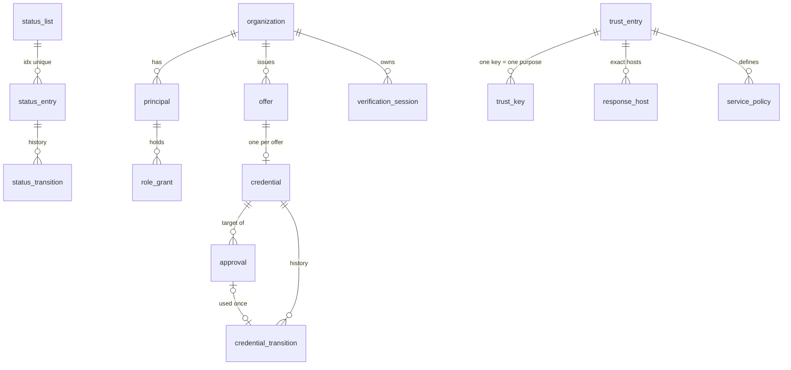

# IQDID — تصميم قاعدة البيانات (TASK-6)

> TEST ONLY. **مقترح غير معتمد.** المخطط الفعلي: `sql/001_schema.sql` (PostgreSQL 16). القيود المشروطة بقرارات معلقة: `sql/090_pending_proposals.sql` (لا تُطبق افتراضياً). الوسوم: **[OAS]** حقل مثبت في عقود OpenAPI v1.1 المسودة؛ **[PROPOSED]** اقتراح TASK-6.

## 1. مبادئ

1. **قاعدة واحدة، مخطط لكل خدمة، دور لكل خدمة**: `iam`, `issuer`, `status`, `trust`, `verifier`, `audit`, `ops`. لا خدمة تقرأ مخطط غيرها إلا حيث يلزم (قراءة `iam` للأدوار).
2. **لا PII كاملة**: `citizen_ref` يُخزن HMAC-SHA-256 (مفتاحه خارج القاعدة). لا أسماء، لا رقم وطني، لا قيم ادعاءات، لا `vp_token`، لا KB-JWT، لا `tx_code` صريح (تجزئة فقط)، لا مفاتيح خاصة.
3. **الإفصاحات لا تلمس القرص** (PRV-05، CTL-24): جلسة المتحقق بيانات وصفية فقط؛ القيم في ذاكرة العملية ≤60ث وقراءة واحدة.
4. **القواعد الحرجة في القاعدة نفسها** (قيود ومشغلات)، وليس في الشيفرة وحدها؛ والشيفرة تكررها (دفاع بعمق).
5. المعرفات UUIDv4 عشوائية (GR-04)؛ الأوقات `timestamptz` UTC (GR-03)؛ أوقات JWT في trust أعداد صحيحة كما في [OAS].

## 2. النموذج المنطقي (ERD مختصر)

ربط C3↔C5 بلا FK عابر للمخططات: `issuer.credential(status_list_id, status_idx)` يقابل `status.status_entry(list_id, idx)`، و`status_entry.credential_ref` UUID عشوائي لا يكشف هوية — حفاظاً على أن C5 لا يعرف المواطن [OAS status-internal].

## 3. الجداول

| الجدول | الغرض | مفاتيح وقيود أساسية | حقول [OAS] |
|---|---|---|---|
| `iam.organization` | المؤسسات | `display_code ~ ^TEST-` | — |
| `iam.principal` | هوية معتمة من AuthProvider | UNIQUE(org, sub)؛ UNIQUE(org, principal_id) للـFK المركب | — (OD-02) |
| `iam.role_grant` | الأدوار | PK(org, principal, role)؛ FK مركب يمنع منح دور عبر مؤسسة | قيم x-roles + `issuer-approver`, `status-writer` [PROPOSED] |
| `issuer.offer` | عروض الإصدار | عمر ≤10د؛ محاولات tx ≤5؛ FK(org, created_by) | offer_id, configuration_id, expires_at |
| `issuer.credential` | مرجع الاعتماد (بلا محتواه) | UNIQUE(offer_id)؛ UNIQUE(list,idx)؛ صلاحية ≤30 يوماً (DR-18)؛ `revoked` نهائي؛ status_ref ثابت؛ `row_version` | credential_id, vct, state, iat, exp, status_ref |
| `issuer.approval` | الموافقة البشرية | approval_ref UNIQUE؛ `approval_not_self`؛ `approval_executor_not_approver`؛ عمر ≤30د؛ FK(org, approved_by, 'issuer-approver') | approval_ref (اختياري في العقد — OD-06) |
| `issuer.credential_transition` | تاريخ الحالة | `approval_id UNIQUE` (استعمال واحد)؛ نمط reason_code | reason_code |
| `status.status_list` | القوائم | bits∈{1,2,4,8}؛ capacity ≥8192؛ `published_le_list`؛ أرقام النسخ أحادية الاتجاه | list_uri, list_version, published_at |
| `status.status_entry` | المواضع | **PK(list_id, idx)** يمنع التخصيص المزدوج؛ UNIQUE(credential_ref)؛ idx < capacity؛ 1 نهائي؛ 2 يتطلب bits≥2 | idx, value |
| `status.status_transition` | تاريخ C5 | approval_ref UNIQUE (منع إعادة الاستعمال T-LC-04) | approval_ref, reason_code |
| `ops.idempotency_record` | Idempotency | PK(service, org, subject, operation, resource, key)؛ تجزئة الجسم؛ ≤24س؛ بلا أجسام | Idempotency-Key (UUID) |
| `trust.trust_list_version` | نسخ القائمة المنشورة | version يتزايد بصرامة (SEC-02) | version, iat, exp |
| `trust.trust_entry` | الجهات | UNIQUE(role, identifier)؛ verifier ⇒ `x509_hash:<43>`؛ issuer ⇒ https | كل حقول TrustEntry |
| `trust.response_host` | مضيفات الرد | مضيف دقيق: بلا wildcard/منفذ/مسار | allowed_response_hosts |
| `trust.trust_key` | هوية المفتاح | PK = RFC7638 thumbprint؛ UNIQUE(cert_sha256)؛ لا حذف (retired_at) ⇒ لا إعادة استعمال عبر الأدوار أو التدوير | **غير موجود في OAS** (تعارض INT-10 `keys`) |
| `trust.service_policy` | سياسات الخدمة | PK(entry, service) | ServicePolicy كـ jsonb |
| `verifier.verification_session` | جلسة التحقق | عمر ≤120ث؛ nonce_sha256 UNIQUE؛ آلة حالات؛ جلب واحد ورد واحد؛ الملكية ثابتة | session_id |
| `audit.audit_event` | C6 | event_id UNIQUE؛ سلسلة تجزئات SHA-256؛ لا UPDATE؛ DELETE داخل التطهير فقط | — |
| `ops.retention_policy` | جدول الاحتفاظ | كل الصفوف `PENDING` | — |

**Consent events:** الموافقة حقلاً حقلاً تحدث في المحفظة C1 (G1b). التصميم المقترح: مخزن محلي مشفر في المحفظة `{event_id, session_ref_hash, verifier_entry_id, field_names[], decision, at}` — أسماء حقول لا قيم. **لا جدول خادم** للموافقة؛ الخادم يسجل `requested_field_names` وحدث تدقيق فقط. NOT IMPLEMENTED (G1b).

## 4. التزامن والمعاملات

| الخطر | الآلية في المخطط | الاختبار |
|---|---|---|
| revoke ↔ reinstate متسابقان (T-LC-02) | `status.set_value`: `SELECT … FOR UPDATE` ثم `UPDATE … WHERE row_version = expected` ⇒ `CAS-4090` | DB-STA-05 |
| فقد تحديث في البناء (T-LC-03) | `list_version` يُرفع داخل المعاملة نفسها؛ النشر يقرأ لقطة بنسخة؛ `published_version` لا ينقص | DB-STA-12/13 |
| revoked → valid/suspended | مشغل `STA-4091` حتى مع UPDATE مباشر؛ 1→1 no-op بلا رفع نسخة | DB-STA-07/08/09 |
| تخصيص idx مرتين | PK(list_id, idx) + UNIQUE(credential_ref)؛ الخدمة تختار idx عشوائياً بـCSPRNG وتعيد عند التصادم | DB-STA-01/02/03 |
| إعادة approval_ref | `consume_approval` ذري (`UPDATE … WHERE consumed_at IS NULL … RETURNING`) + UNIQUE في التاريخين | DB-APR-04..09، DB-STA-10 |
| Idempotency in-flight | INSERT في PK أولاً (`in_flight`) — المتسابق الثاني يفشل بمفتاح مكرر ⇒ 409 API-4090؛ تجزئة جسم مختلفة ⇒ 409 | DB-IDM-01/02 |
| سلسلة التدقيق | قفل استشاري لكل إدراج | DB-AUD-05 |

مستوى العزل: `READ COMMITTED` يكفي مع الأقفال الصفية وCAS أعلاه؛ `SERIALIZABLE` اختياري لـC5 بعد قياس الأداء — PENDING.

**التعارض المفتوح (D-04):** المعاملة تحفظ التغيير و`list_version` حتى لو فشل النشر؛ بينما ردود 200 في العقد تشترط `list_version/published_at`. التصميم يدعم `published_version < list_version` كحالة «معلق النشر» لكن دلالة الرد (202/503) غير محسومة — انظر Open Decisions.

## 5. الاحتفاظ والحذف (كلها PENDING — OD-04، CTL-44)

| الكائن | المدة المقترحة | الآلية |
|---|---|---|
| إفصاحات المتحقق | 0 على القرص؛ ≤60ث ذاكرة | تصميم الخدمة (لا جدول) |
| جلسة تحقق (وصفية) | 24س بعد الانتهاء | `ops.purge_expired()` |
| Idempotency | ≤24س | قيد + تطهير |
| عرض إصدار | 10د صلاحية، يوم للتشغيل | حالة `expired` |
| موافقات/تاريخ الحالة | 36 شهراً | مقترح |
| التدقيق | 36 شهراً (الحوكمة §18 مقترح) | حذف بالتطهير فقط + حدث `retention.purge` |

الحذف من التدقيق يكسر سلسلة التجزئات من البداية؛ المقترح: حفظ `hash` آخر حدث محذوف في حدث التطهير كمرساة — **غير منفذ** (يحتاج INT-16).

## 6. التحويل إلى migrations

`001_schema.sql` أحادي ومعاملاتي، صالح كـ migration أولى. المقترح: أداة migrations بملفات SQL مرقمة ومثبتة بتجزئة (مثل نهج Flyway/Sqitch/node-pg-migrate — الاختيار PENDING، ولا تغيير لتبعيات الإنتاج في TASK-6). قواعد: لا تعديل migration منشورة؛ كل migration تُختبر بـ`tools/run_db_tests.sh` + الطفرات؛ 090 لا يُدمج قبل اعتماد OD-06/OD-07.

## 7. ما ليس مضموناً

القيود لا تثبت أن الخدمات ستستدعي `set_value`/`consume_approval` (تجاوز ممكن بشيفرة خاطئة تملك الامتياز)؛ لا تثبت صحة التوقيعات أو التفويض على مستوى HTTP؛ ولا تحل OD-01 (السياسة تحددها الخدمة، والقاعدة تحفظ الملكية فقط). أي ضابط هنا **مصمم ومختبر على مستوى القاعدة** فقط، لا «مطبق في النظام».
